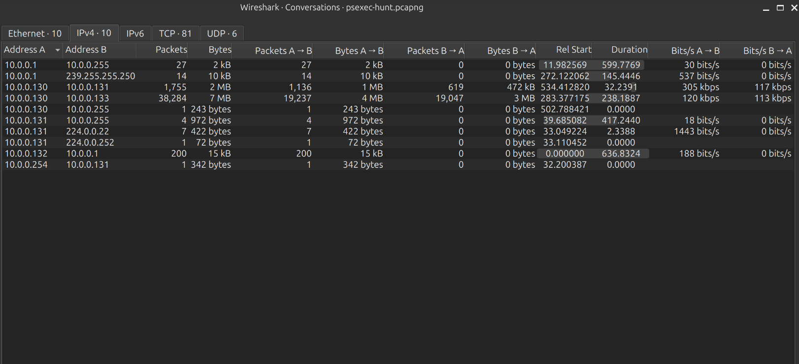
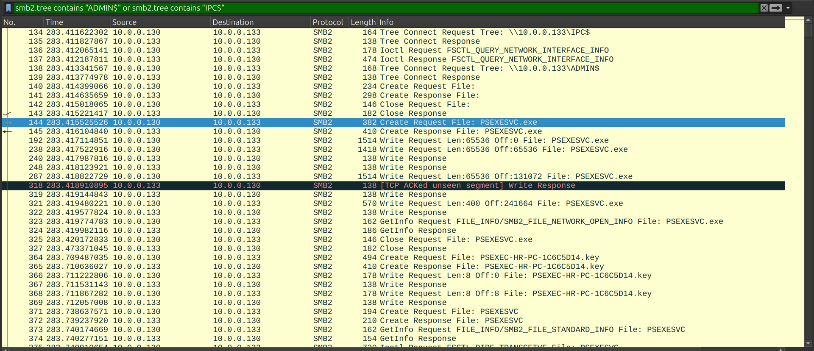
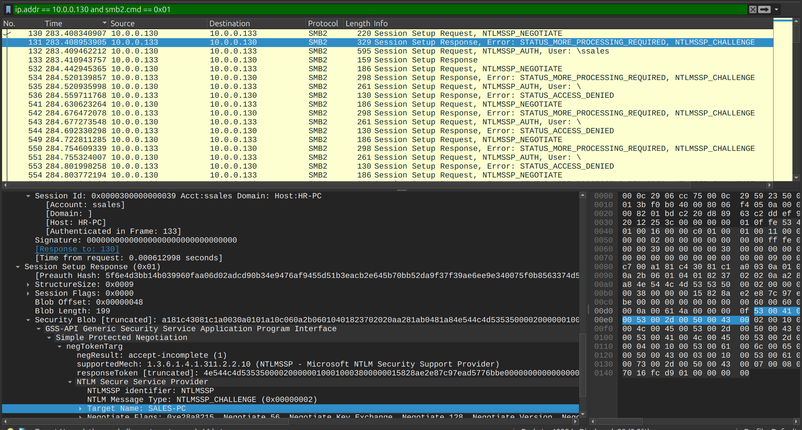
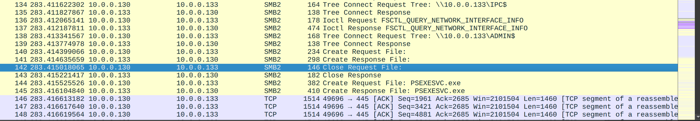
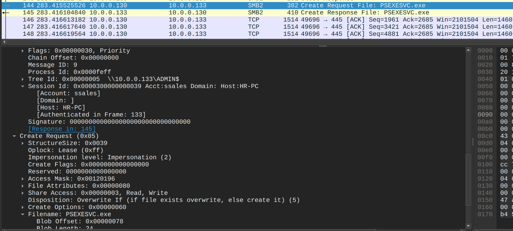
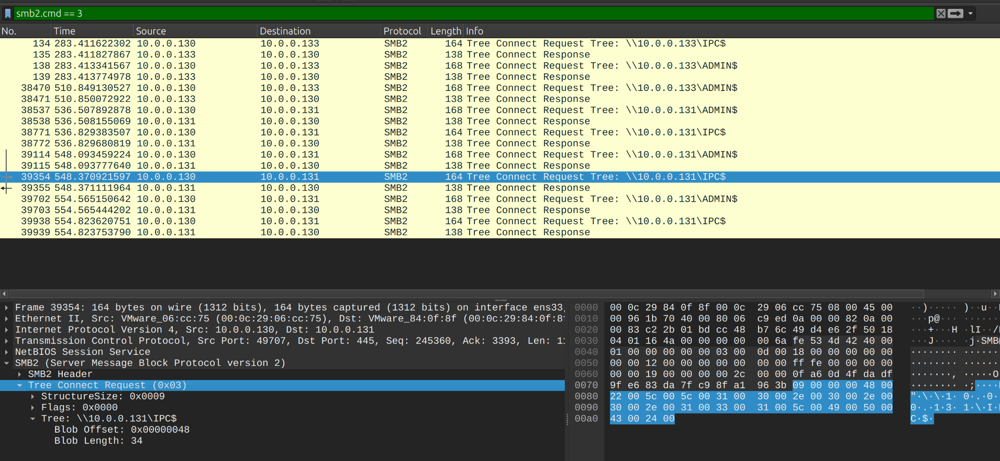
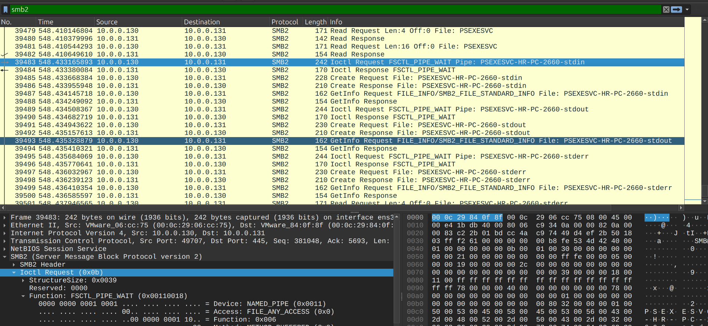
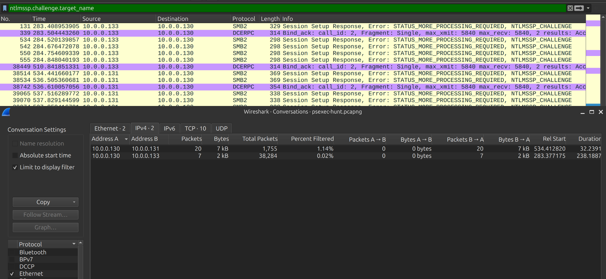
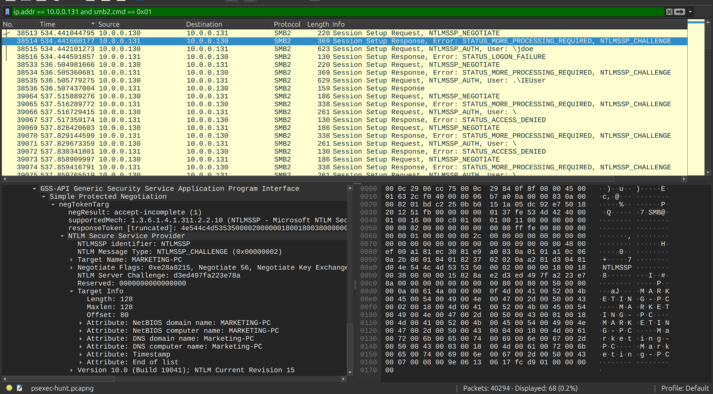
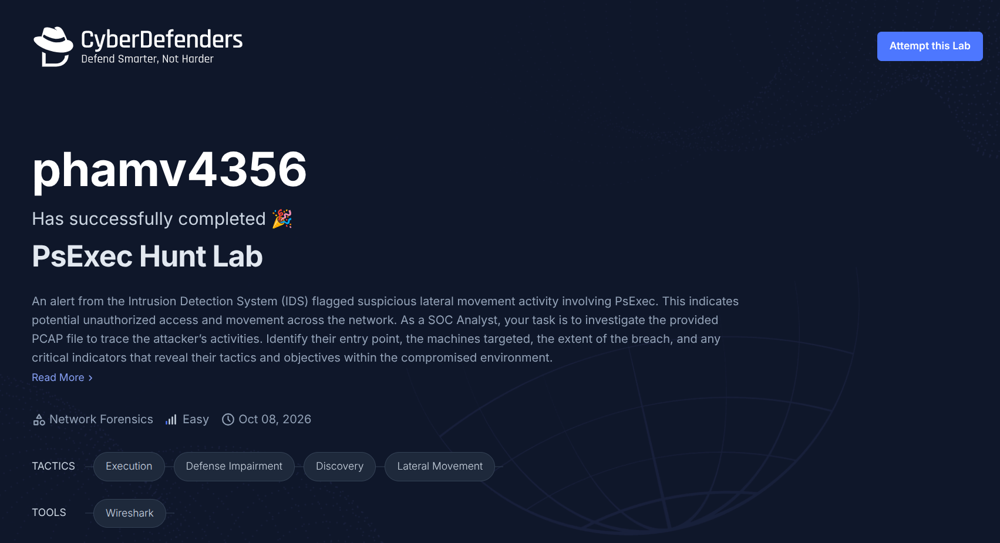

Scenario: An alert from the Intrusion Detection System (IDS) flagged suspicious lateral movement activity involving PsExec. This indicates potential unauthorized access and movement across the network. As a SOC Analyst, your task is to investigate the provided PCAP file to trace the attacker’s activities. Identify their entry point, the machines targeted, the extent of the breach, and any critical indicators that reveal their tactics and objectives within the compromised environment.

**Question 1:** To effectively trace the attacker's activities within our network, can you identify the IP address of the machine from which the attacker initially gained access?

Figure 1:

There are a numerous of packets sent between 10.0.0.130 and 10.0.0.133, this seems quite suspect. First, we need to understand how PsExec work before investigating:

PsExec is a lightweight command-line utility from Microsoft Sysinternals that lets you run programs or commands on remote Windows systems. It connects over SMB (port 445), copies a temporary service file (PSEXESVC.exe) to the remote machine's ADMIN\$ share, runs the command via Windows Services, and cleans up afterward.

Workflow of PsExec:

- **Authentication & Connection:** Client runs the command locally with target credentials. PsExec connects to the remote PC using SMB over TCP port 445.

- **File Upload:** It extracts an embedded service executable (PSEXESVC.exe) and copies it to the remote C:\Windows folder (via the hidden ADMIN\$ share).

- **Service Creation:** It uses the Windows Service Control Manager (SCM) remotely to register and start PSEXESVC as a temporary system service.

- **Command Execution:** The remote service runs your requested application or command using the credentials you provided (or under the local SYSTEM account if requested).

- **I/O Redirection:** It pipes the command's input, output, and error streams back to your local console window.

- **Cleanup:** Once the process finishes, PsExec stops and deletes the remote PSEXESVC service and binary file.

Now, I’ll look up SMB packets using shares like ADMIN\$ or IPC\$:

Figure 2:

As shown in Figure 2, there are lots of SMB packets involved in establishing PsExec service on the target machine as I mentioned above. The communication is mainly between 10.0.0.130 and 10.0.0.133.

=\> Answer: 10.0.0.130

**Question 2:** To fully understand the extent of the breach, can you determine the machine's hostname to which the attacker first pivoted?

Figure 3:

The target machine sends the NTLMSSP Challenge to securely verify the client's identity without exposing sensitive information. To find the hostname, check the Target Name field in the challenge message.

=\> SALES-PC

- Host (HR-PC): This is the client machine (the attacker's machine, IP 10.0.0.130) initiating the connection. Wireshark extracts this hostname from the client's NTLMSSP_AUTH packet (like in packet 132), where the client identifies its own workstation name during login.

- Target Name (SALES-PC): This is the server machine (the target, IP 10.0.0.133) responding to the connection. In packet 131, the server sends an NTLMSSP_CHALLENGE back to the client, and as part of that challenge, it provides its own local computer name (SALES-PC).

See more details about this protocol in \[1\]

**Question 3:** Knowing the username of the account the attacker used for authentication will give us insights into the extent of the breach. What is the username utilized by the attacker for authentication?

From the figure 3, we can see the attacker is using the username “ssales” for authentication in the packet no. 132.

=\> Answer: sales

**Question 4:** After figuring out how the attacker moved within our network, we need to know what they did on the target machine. What's the name of the service executable the attacker set up on the target?

Figure 4:

Let me explain workflow details in figure 4:

- Create Request File without a filename: In the SMB protocol, a Create Request with an empty filename (such as packet 140) is actually a request to open the root directory of the share itself, rather than a specific file. Because this request happens immediately after connecting to the ADMIN\$ share in packet 138, the client is asking the server for a handle to the ADMIN\$ root directory. This is an automatic check done by the client to verify it has the appropriate access rights and permissions to that folder before it attempts to upload the actual payload, PSEXESVC.exe, in packet 144. After getting the directory handle, it immediately closes it in packet 142.

<!-- -->

- The IOCTL Request: The Ioctl Request FSCTL_QUERY_NETWORK_INTERFACE_INFO (packet 136) is generated automatically by the underlying SMB client, not by a specific command typed by the attacker. This is a standard Windows SMB behavior related to a feature called SMB Multichannel. When a client establishes a connection to an SMB server, it automatically queries the server for its network interfaces to determine if there are multiple network paths (like extra network cards) available to speed up the transfer or provide fault tolerance.

=\> The answer of this question is simply **psexesvc.exe.**

**Question 5:** We need to know how the attacker installed the service on the compromised machine to understand the attacker's lateral movement tactics. This can help identify other affected systems. Which network share was used by PsExec to install the service on the target machine?

To determine the answer of this question, I’ll access the packet record no. 144 to know what network share was used to install PsExec on the target machine.

Figure 5:

As we can see in figure 5, the “Tree Id” section displays ADMIN\$. This is also the path which executable file was installed in the target machine.

=\> Answer: ADMIN\$

**Question 6:** We must identify the network share used to communicate between the two machines. Which network share did PsExec use for communication?

Figure 6:

As shown in figure 6, beside the ADMIN\$, there are also IPC\$. This is commonly network shared for establishing Command & Control Channel. After PsExec uploads the service binary through the ADMIN\$ share, it relies on IPC\$ as the communication channel to send commands, stream standard input/output (stdin, stdout, stderr), and receive execution results back from the remote host.

We also have another records display stdin, stdout, stderr. As the result, this is strong indicators to identify the network share used to communicate between the two machines is IPC\$.

Figure 7:

=\> Answer: IPC\$

**Question 7:** Now that we have a clearer picture of the attacker's activities on the compromised machine, it's important to identify any further lateral movement. What is the hostname of the second machine the attacker targeted to pivot within our network?

I applied a display filter on wireshark to view network authentication packets involve smb traffic: ntlmssp.challenge.target_name

Figure 8:

As shown in figure 8, beside the first target 10.0.0.133, there are also another host 10.0.0.131. This is probably the second machine the attacker is move on.

Focus on that machine and check the authentication packets:

=\> hostname of the second machine: **MARKETING-PC**

# COMPLETION:

# REFERENCES:

\[1\] [<u>https://learn.microsoft.com/en-us/openspecs/windows_protocols/ms-smb2/b99264a6-7520-4563-adaf-fc4fdf7d5a1b</u>](https://learn.microsoft.com/en-us/openspecs/windows_protocols/ms-smb2/b99264a6-7520-4563-adaf-fc4fdf7d5a1b)
