**Scenario:** Our intrusion detection system has alerted us to suspicious behavior on a workstation, pointing to a likely malware intrusion. A memory dump of this system has been taken for analysis. Your task is to analyze this dump, trace the malware’s actions, and report key findings.

In this lab, we are provided a memory dump of a Windows workstation

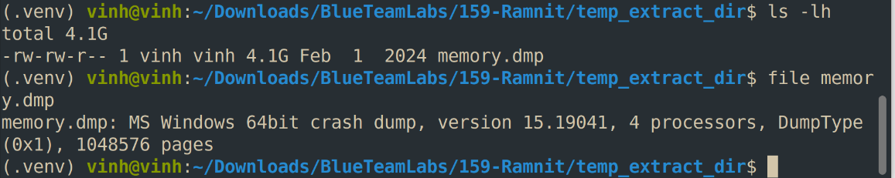

**Q1:** What is the name of the process responsible for the suspicious activity?

I’ll use Volatility 3 to analyze this dump file using windows.pstree plugin

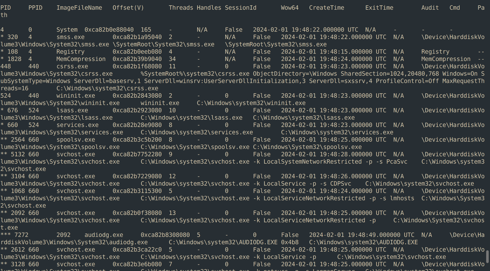

- (Desktop Window Manager) is a legitimate Microsoft Windows system process that manages visual effects on your desktop.

- Winlogon.exe (Windows Logon Application): là một tiến trình hệ thống cốt lõi và hoàn toàn hợp pháp của hệ điều hành Microsoft Windows, có nhiệm vụ quản lý các chức năng liên quan đến quá trình đăng nhập và bảo mật phiên làm việc của người dùng

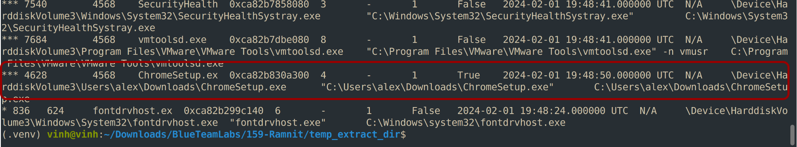

Look at the last lines in the output, we can see ChromeSetup.exe process has several abnormal points:

- It runs from C:\Users\alex\Downloads\\ launched by explorer.exe (so someone double-clicked it), at 19:48:50. That is only about 25 seconds after the desktop session started.

- It is still running, with no exit time, while the dump was taken at 19:53 or later. A real Chrome stub installer normally downloads and launches the real setup within a minute, then exits.

- It has no child processes and no Chrome or Google Update processes exist anywhere in the tree. A legitimate installer that had been running for 4+ minutes would normally have spawned some.

- Fake Chrome installers are a very common malware delivery method, so the name alone proves nothing. A real stub and a trojan can look the same here.

**Q2:** What is the exact path of the executable for the malicious process?

Exact path locate in last column show in above figure

=\> Answer: C:\Users\alex\Downloads\ChromeSetup.exe

**Q3:** Identifying network connections is crucial for understanding the malware's communication strategy. What IP address did the malware attempt to connect to?

Use the netscan plugin to list network connections and search for connections involving the suspicious process.

Run this command:

vol -f memory.dmp windows.netscan \| grep “Chrome”

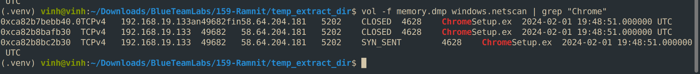

=\> Answer: 58.64.204.181

**Q4:** To determine the specific geographical origin of the attack, Which city is associated with the IP address the malware communicated with?

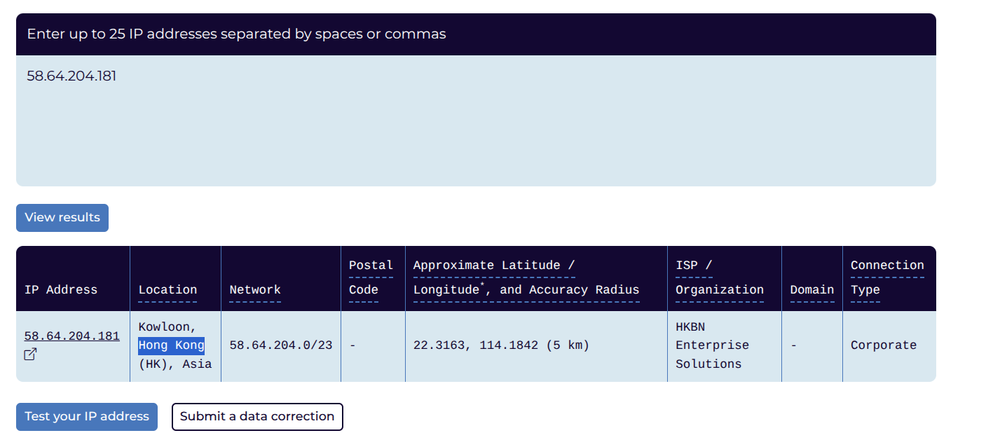

=\> Answer: Hong Kong

**Q5:** Hashes serve as unique identifiers for files, assisting in the detection of similar threats across different machines. What is the SHA1 hash of the malware executable?

- To get the hash of the suspicious executable, we’ll need to first dump the file from memory.

1.  filescan lists FILE_OBJECTs, not files. Every time something opens a file, Windows creates a new FILE_OBJECT structure in kernel memory. Each has its own offset. Three offsets for ChromeSetup.exe means the path was opened three times (or opened, closed, and left behind in memory).

2.  Different openers. Typical reasons for ChromeSetup.exe in particular:

    - explorer.exe opened it when the user double-clicked (and read its icon, properties, and version info)

    - The process loader opened it to map the image when it launched

    - Windows Defender or SmartScreen opened it to scan it on download or execution

    - The process itself may hold an open handle to its own file

3.  Stale objects. filescan scans raw memory for pool tags, so it also finds FILE_OBJECTs that were already closed but not yet overwritten. That’s why you can see more entries than there are currently open handles.

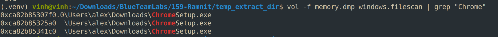

\*Note: We can use one of offsets it will same result

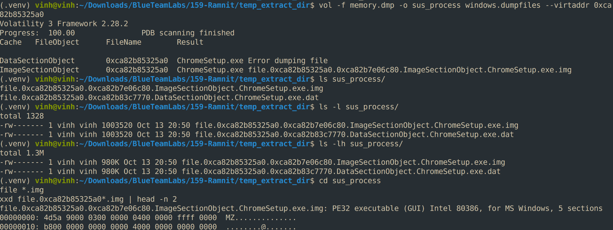

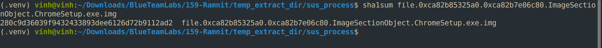

=\> Answer: 280c9d36039f9432433893dee6126d72b9112ad2

**Q6:** Examining the malware's development timeline can provide insights into its deployment. What is the compilation timestamp for the malware?

Paste above sha1 hash to virustotal and look for information we need

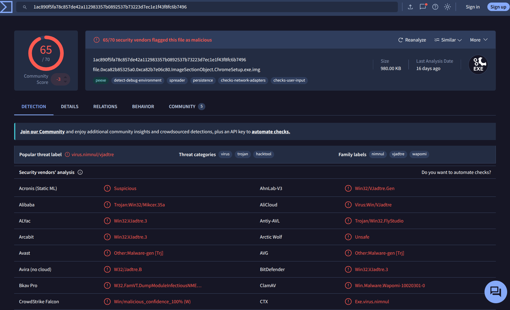

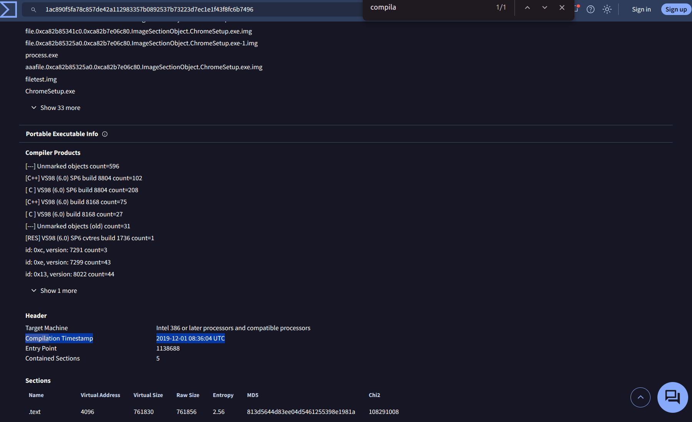

=\> Answer:

2019-12-01 08:36

Other way: We can use peinfo to analyze PE header and extract compilation timestamp inside it

**Q7:** Identifying the domains associated with this malware is crucial for blocking future malicious communications and detecting any ongoing interactions with those domains within our network. Can you provide the domain connected to the malware?

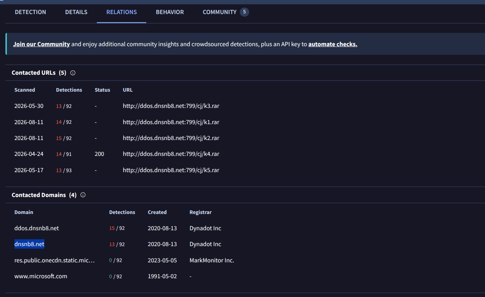

=\> Answer: [<u>dnsnb8.net</u>](https://www.virustotal.com/gui/domain/dnsnb8.net)

# COMPLETION:

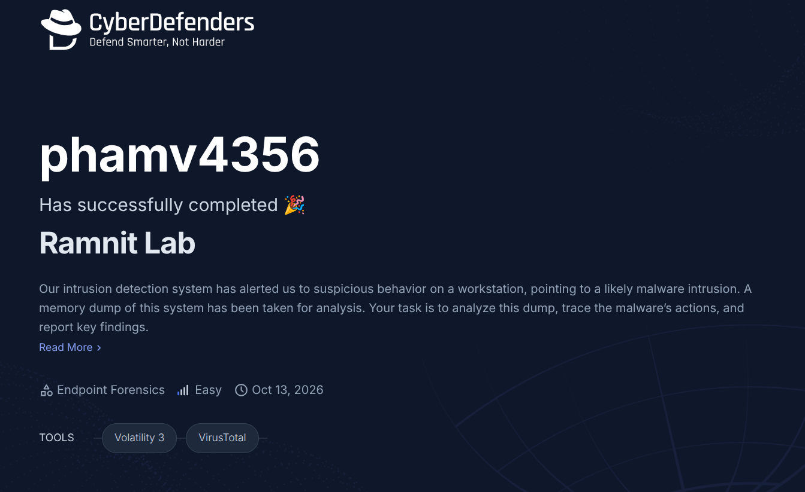

The link: [<u>https://cyberdefenders.org/blueteam-ctf-challenges/achievements/phamv4356/ramnit/</u>](https://cyberdefenders.org/blueteam-ctf-challenges/achievements/phamv4356/ramnit/)
