**Scenario:** We're currently in the midst of a murder investigation, and we've obtained the victim's phone as a key piece of evidence. After conducting interviews with witnesses and those in the victim's inner circle, your objective is to meticulously analyze the information we've gathered and diligently trace the evidence to piece together the sequence of events leading up to the incident.

We are provided a folder contain Android filesystem root

It contains directories such as:

- /system

- /vendor

- /data

- /app

- /user

- /cache

- /misc

- /property

- /sdcard-like paths such as /media and /local

- /adb, /bootchart, /tombstones, /ota

This is the structure of a rooted/Android partition tree, typically extracted from a firmware or device image. In short: it contains Android OS and app data partitions, not source code files for a typical app.

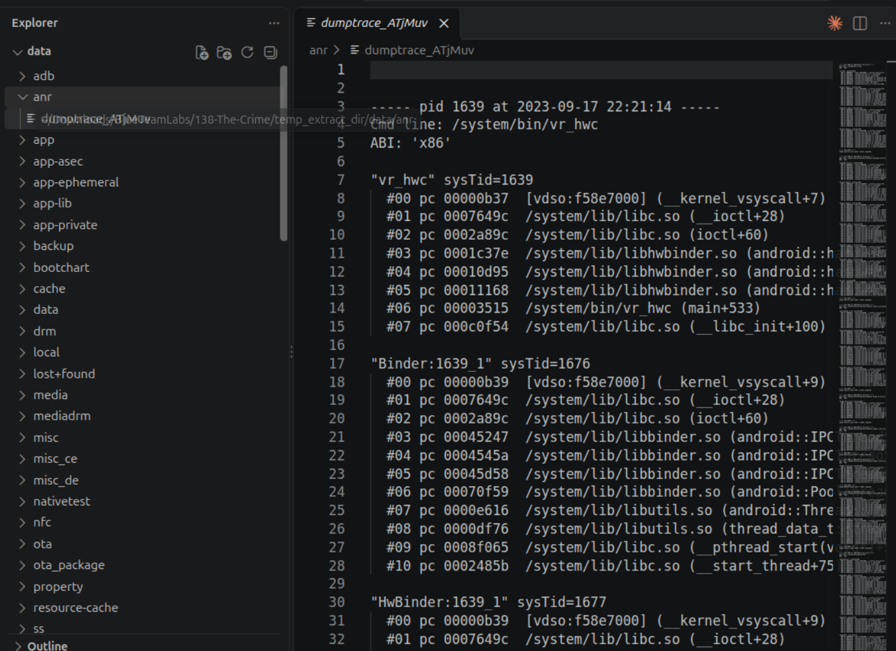

Android ANR = Android Application Not Responding: It happens when the UI thread of an Android app is blocked for too long =\> This error is triggered \[1\].

This is not a real physical phone; it is an Android emulator / virtual device image.

- Android 9 (Pie)

- Google SDK emulator image

- device name/model family: sdk_gphone_x86_arm

- build tag: userdebug/dev-keys

First, we need install ALEAPP tool to analyze this filesystem

clone repo and create python environment to install package or dependencies follow the guide in [<u>README.md</u>](http://readme.md)

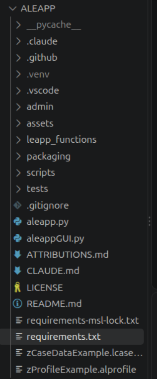

We can use ALEAPP GUI or CLI to extract artifacts from Android file system. In this case, I prefer to use ALEAPP GUI 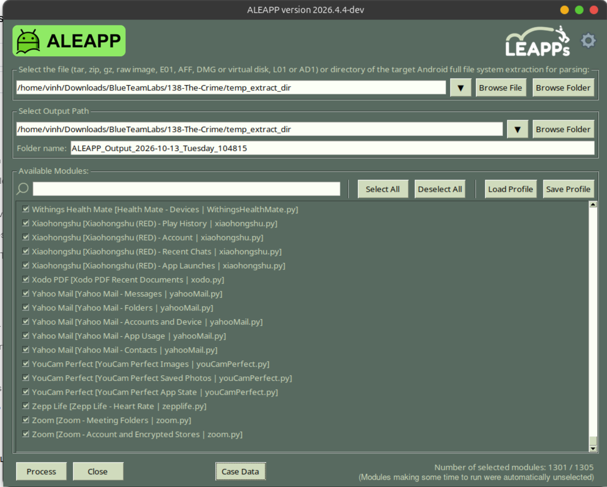

Click on “process” button and wait for it processing

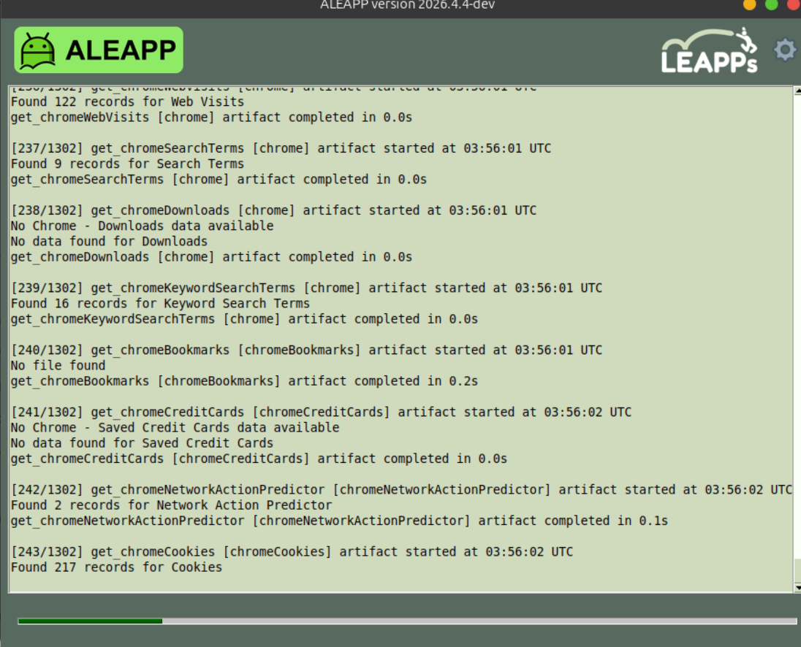

Processing complete:

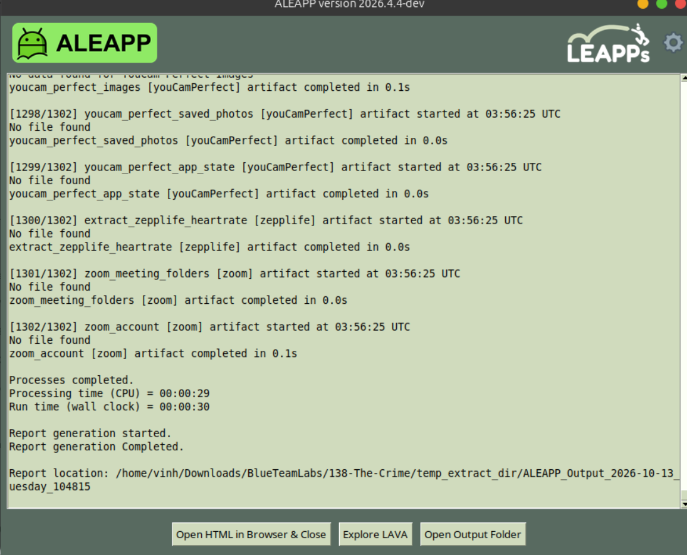

Open the report it just created:

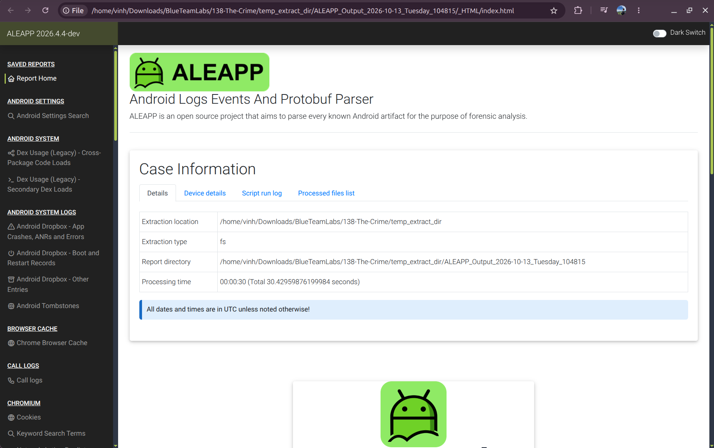

Q1: Based on the accounts of the witnesses and individuals close to the victim, it has become clear that the victim was interested in trading. This has led him to invest all of his money and acquire debt. Can you identify the SHA256 of the trading application the victim primarily used on his phone?

To solve this question, I access to the Installed App section and search keyword related to trading

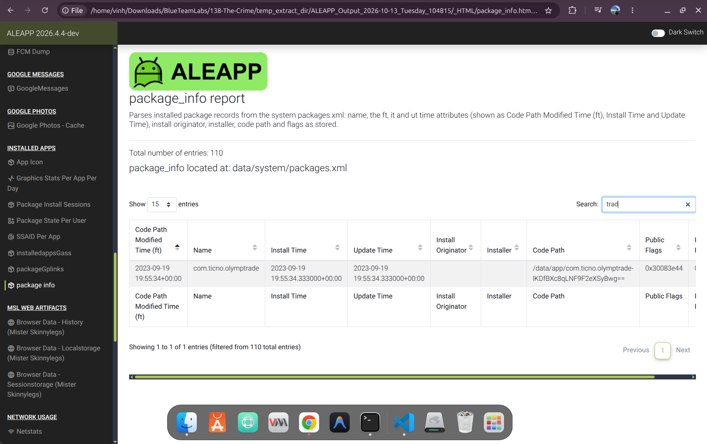

Go to installedappsGass, this is where the Parsed application records (bundle ID, version code and SHA-256 hash) from the app_info table of each Google Play services gass.db.

gass.db: is a small SQLite database file created by Google Play Services (and sometimes by apps that use Google’s ads SDK).

What it’s for: It’s generally associated with Google’s ad and security signals system (the “GASS” name is commonly linked to this, though Google doesn’t publicly document the exact expansion). The data helps Google’s ads and anti-fraud systems verify that ad requests come from real, legitimate apps and devices rather than bots or tampered software.

Where you’ll see it: Usually in the app’s private data folder, such as /data/data/com.google.android.gms/databases/, which you can only reach with root access or a file explorer on a rooted device. Some people notice it in app cache or data folders when using a file manager or backup tool.

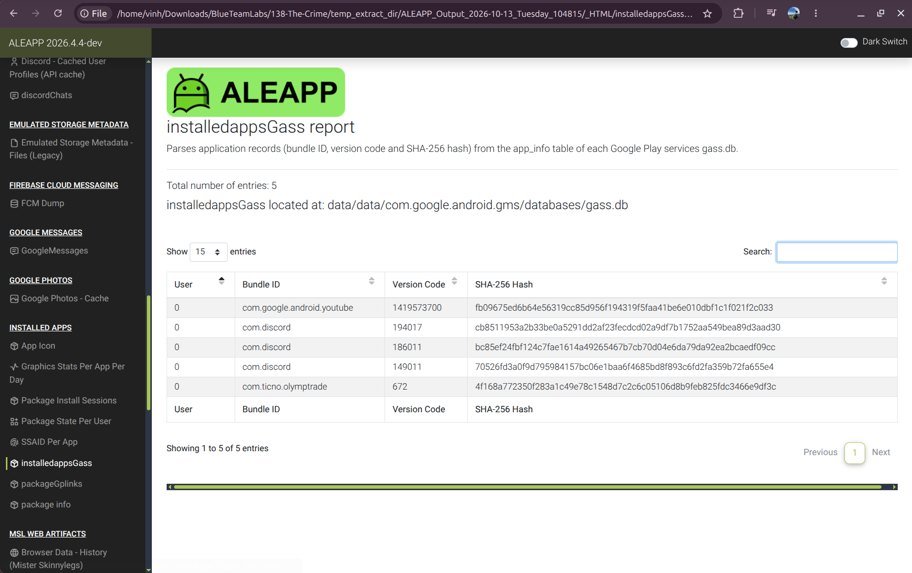

=\> Answer: 4f168a772350f283a1c49e78c1548d7c2c6c05106d8b9feb825fdc3466e9df3c

Q2: According to the testimony of the victim's best friend, he said, "While we were together, my friend got several calls he avoided. He said he owed the caller a lot of money but couldn't repay now". How much does the victim owe this person?

Go to the SMS Messages section, we can see this message the victim received:

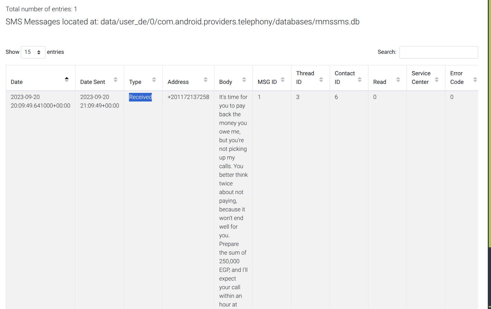

=\> Answer: 250,000 EGP

Q3: What is the name of the person to whom the victim owes money?

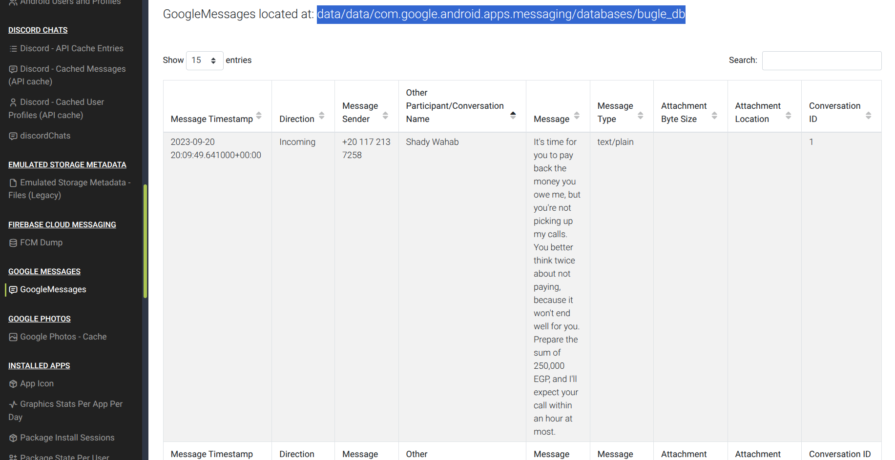

bugle_db is the main SQLite database for Google Messages (package com.google.android.apps.messaging). “Bugle” was the internal codename for the app. It’s where the app stores your SMS, MMS, and RCS chats locally on the phone.

What’s inside (main tables)

- messages: The text of each message, timestamps, sent/received status, and the sender.

- conversations: One row per chat thread, including the last message preview, unread state, pinned/archived flags, and notification settings.

- participants: Phone numbers, contact names, and contact IDs for the people in your chats.

- conversation_participants: Links people to the conversations they belong to.

- parts: The pieces of each message, such as text, images, video, audio, or files (the actual media files are usually stored elsewhere, and this table points to them).

- Other tables: Things like draft messages, RCS/chat features state, spam or blocked-number data, and app settings.

=\> Answer: Shady Wahab

Q4: Based on the statement from the victim's family, they said that on September 20, 2023, he departed from his residence without informing anyone of his destination. Where was the victim located at that moment?

But this is not the final answer for this question, because that is only the location they meet. I need investigate more specific location in GPS data:

The Hint: The victim's location on September 20, 2023, was determined using GPS-related data extracted from their Android device. This data was retrieved using forensic tools such as ALEAPP, which analyzed activity logs and recent tasks.

Go to recent Activity tab and sort timestamp by increasing:

the victim used google maps to determined location he wanted to go

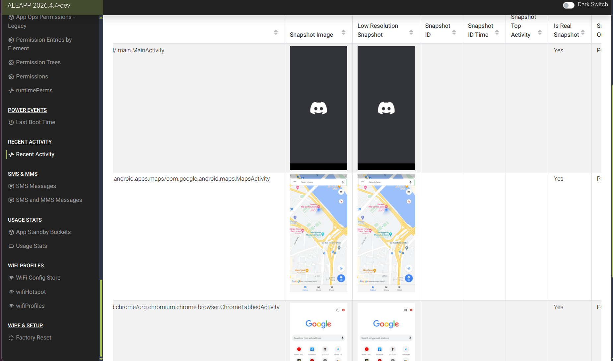

=\> Answer: The Nile Ritz-Carlton

Q5: The detective continued his investigation by questioning the hotel lobby. She informed him that the victim had reserved the room for 10 days and had a flight scheduled thereafter. The investigator believes that the victim may have stored his ticket information on his phone. Look for where the victim intended to travel.

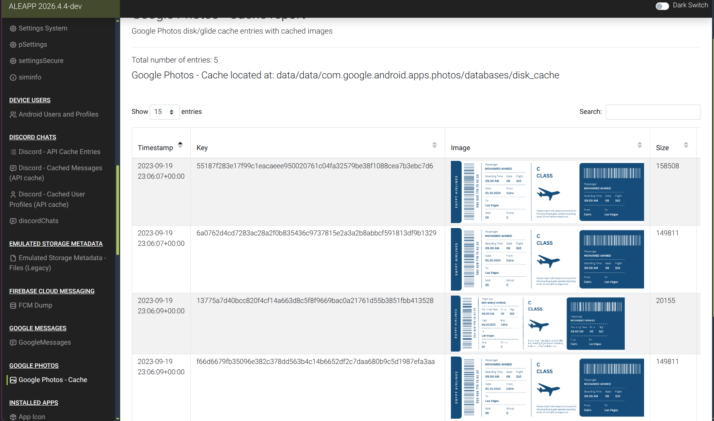

=\> Answer: Las Vegas

Q6: After examining the victim's Discord conversations, we discovered he had arranged to meet a friend at a specific location. Can you determine where this meeting was supposed to occur?

He’s going to Las Vegas, but I want to know his specific location when he arrives. Investigate further in discord chat conversation, now we can see:

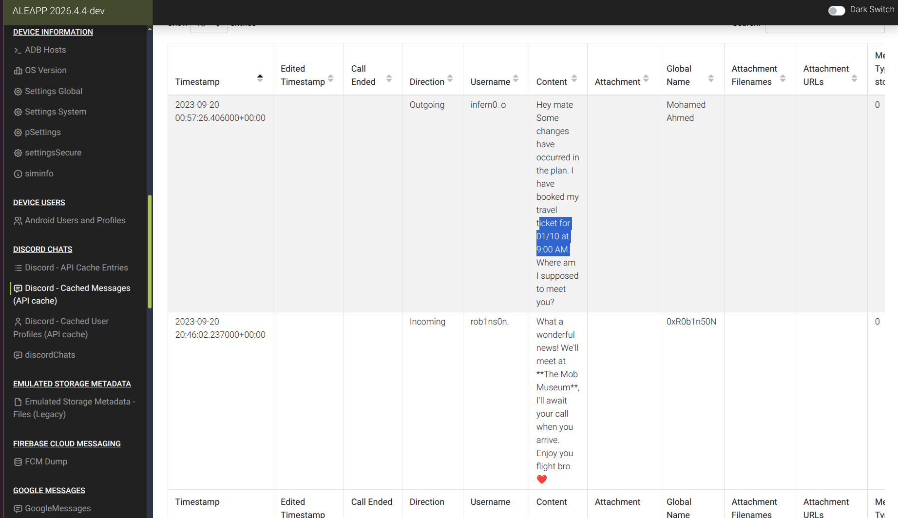

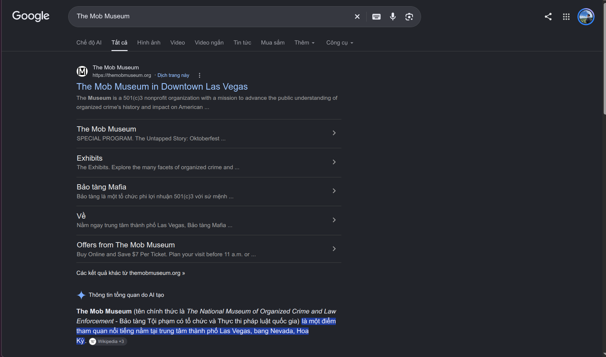

=\> Answer: The Mob Museum

CONCLUSION

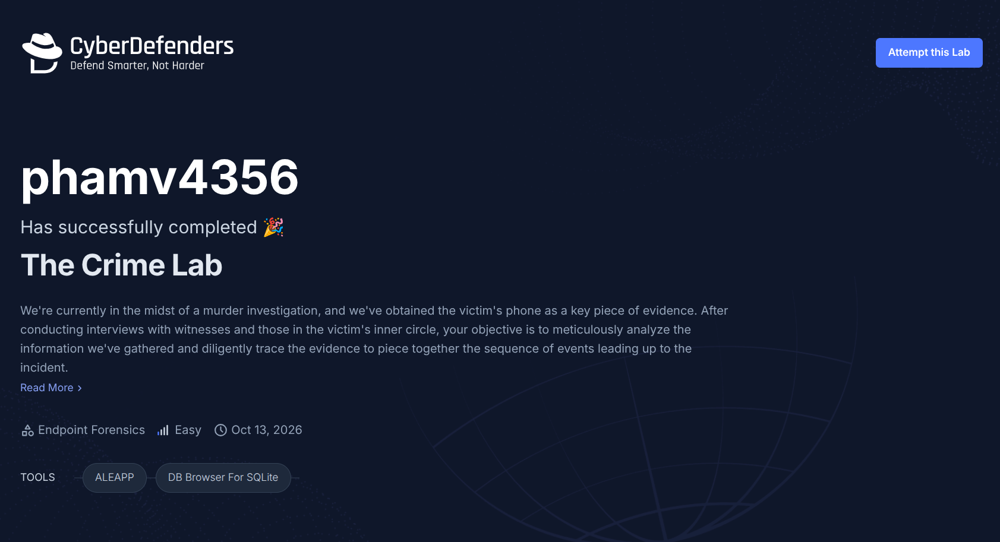

REFERENCES:

\[1\] [<u>https://developer.android.com/topic/performance/issues/anr</u>](https://developer.android.com/topic/performance/issues/anr)

\[2\] [<u>https://davidjosearaujo.gitbook.io/online-courses/android-analysis/android-analysis/triaging-with-aleapp</u>](https://davidjosearaujo.gitbook.io/online-courses/android-analysis/android-analysis/triaging-with-aleapp)

\[3\] [<u>https://htiservices.vn/giam-dinh-tin-nhan-tren-cac-thiet-bi-android/</u>](https://htiservices.vn/giam-dinh-tin-nhan-tren-cac-thiet-bi-android/)
